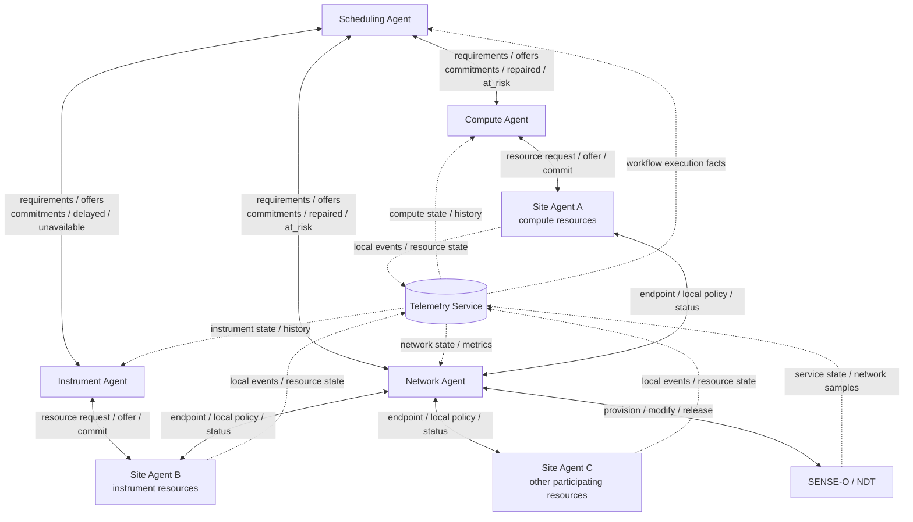

# 2026-09-21 Cross-site architecture v2：本轮定稿

> **范围**：记录 2026-09-20 至 2026-09-21 对话中关于 cross-site orchestration 的最终拓扑、职责划分、信息流和示例。按当前讨论要求，本版暂不画 WMS。
>
> **状态**：这是本轮讨论形成的 working architecture，不代表 KK 或项目全体已经批准。`resources/20260920_crosssite.md`（若保留）记录思考过程；本文只保留当前结论。

## 一、核心结论

当前架构采用：

- 一个全局 **Scheduling Agent**；
- 三类全局 resource agents：**Compute Agent、Instrument Agent、Network Agent**；
- 每个站点一个 **Site Agent**，封装本站异构资源和策略；
- 一个共享的 **Telemetry Service**；
- Network Agent 通过 **SENSE-O / NDT** 申请和调整跨站网络资源；
- 暂不设置 Storage Agent。

最重要的职责边界是：

> **Telemetry Service 提供观测事实；resource agents 提供各自资源领域内的决策、offers 和 commitments；Scheduling Agent 负责跨资源、跨站点和跨 workflow 的最终协调。**


## 二、最终逻辑拓扑




图中：

- **实线**表示资源请求、协商、承诺或控制动作；
- **虚线**表示 telemetry、events、历史数据或状态订阅；
- 连线表示逻辑接口，不要求所有组件都是独立进程；
- resource agent 只连接提供相应资源的站点，不是物理上的全连接。

无法渲染 Mermaid 时，可用下面的简化图理解：

```text
                         Scheduling Agent
                    /           |           \
          Compute Agent  Instrument Agent  Network Agent ── SENSE-O/NDT
               ↕                ↕                ↕
        relevant Site     relevant Site     participating Sites
             Agents            Agents             Agents
                 \              |              /
                  ─────── Telemetry Service ───────
                              │
                  workflow facts → Scheduling Agent
```


## 三、为什么不是每个站点各放一套完整 scheduling/network agents？

本版暂不采用“每个 site 都部署完整 Scheduling Agent 和 Network Agent”的方案，原因是：

- 完整 workflow DAG、deadline 和跨 workflow arbitration 需要一个全局视图；
- 跨域网络容量与多个站点之间的 transfer commitments 也需要统一协调；
- 每站点复制完整 agents 会引入 agent-to-agent 协议、状态一致性和重复优化问题；
- 站点异构性与本地自治可以由一个 Site Agent 加内部 adapters 封装。

因此当前边界是：

> **Global agents 负责跨站协调；Site Agent 负责本地 admission、适配、执行和状态上报。**

如果未来发现某站点确实需要更强的本地自治，可以在 Site Agent 内增加 scheduling adapter 或 network adapter，甚至升级为本地 agent；但它们不应复制另一套独立的全局 optimizer。

## 四、各组件职责


### 1. Scheduling Agent

Scheduling Agent 是唯一的跨资源协调者，负责：

- 理解 workflow DAG、task dependency 和 file dependency；
- 处理 deadline、priority、slack 与多 workflow 竞争；
- 把 workflow 需求转换为 compute、instrument 和 network requirements；
- 汇总各 resource agents 返回的 offers；
- 选择能够组成完整 workflow plan 的 offer 组合；
- 在实际运行偏离计划时传播影响并重新调度。

它不直接决定某条网络路径、某个本地 compute node 或仪器的内部配置。这些由相应 resource agent 和 Site Agent 处理。

### 2. Compute Agent

Compute Agent 负责跨站 compute resource selection 和协商：

- 找到满足 CPU、GPU、memory、software environment 等要求的站点；
- 获取 queue time、earliest start、预计 runtime 和完成时间；
- 比较 best-effort、整节点预留或其他计算资源模式；
- 向相关 Site Agents 请求、hold、commit、modify 或 release compute resources；
- 在运行中判断 compute commitment 是否仍可满足，并向 Scheduling Agent 报告新的 offer、`at_risk` 或 `unavailable`。

Compute Agent 不代替 Slurm、HTCondor、Kubernetes 等本地 scheduler。它从多个站点获得 offers，真正的本地 node placement 仍由站点控制。

### 3. Instrument Agent

Instrument Agent 负责跨站 instrument selection 和时间协商：

- 查找符合实验需求的仪器；
- 处理仪器预约窗口、准备时间、运行时间和数据生成时间；
- 表达样品、人员、安全和 facility policy 等限制；
- 向相关 Site Agents 请求和确认仪器时间；
- 在仪器延期、取消或故障时提供新的完成时间或替代 offer。

Instrument Agent 的关键输出不只是“仪器可用”，还包括预计 `dataReadyAt` 和数据规模，因为它们决定后续 transfer 与 compute 的最早开始时间。

### 4. Network Agent

Network Agent 负责跨站网络资源：

- 接收 source、destination、bytes、earliest start、latest finish 等 requirement；
- 维护跨 workflow 的 network capacity ledger；
- 返回可行的 bandwidth / time-window offers；
- 通过 SENSE-O / NDT 执行 hold、commit、modify 和 release；
- 与各 Site Agent 协调本站 endpoint、DTN、local policy 和接入状态；
- 使用网络 telemetry 检测偏差，能局部修复时报告 `repaired`，无法满足承诺时报告 `at_risk`。

Network Agent 理解网络承诺，但不理解完整 workflow。因此它只提供可行方案，由 Scheduling Agent 决定哪一个方案最适合全局 workflow。

### 5. Site Agent

每个站点部署一个 Site Agent。它是站点的统一身份、policy boundary 和 adapter layer，负责：

- 发布本站 compute、instrument、storage、DTN 和 network endpoint 能力；
- 把统一请求翻译成 Slurm、HTCondor、Kubernetes、instrument controller、Site-RM 等本地接口；
- 根据本站 allocation、policy 和实时状态接受、拒绝或 counter-offer；
- 将确认后的请求交给本站原有 scheduler / controller 执行；
- 监控本地任务、仪器、数据和 endpoint 状态；
- Report the local events and resource state to the Telemetry Service；
- 在不改变全局承诺的前提下做有限本地恢复。

> 指本站内部发生小故障时，Site Agent 可以自行修复，而不需要全局重新调度。例如：
>
> - 某个计算节点故障，换到本站另一台等价节点
> - 本地任务失败，自动重试
> - 一个 DTN 故障，切换到本站备用 DTN
> - 仪器控制服务短暂异常，重启后继续
> - 本地网络接口故障，切换备用接口
>
> 前提是修复后仍能满足原来的承诺，例如：
>
> - 完成时间不变
> - 数据位置和接口仍然可用
> - 已预约的传输窗口不受影响
> - 所需资源规模不变
>
> 如果修复会导致任务晚完成、改变 endpoint 或错过 transfer window，就不能只在本地处理，必须通知 Scheduling Agent 重新规划。

Site Agent 接收的不是必须无条件执行的 `command`，而是可以协商的 `request`。站点始终保留本地控制权。

### 6. Telemetry Service

Telemetry Service 不是资源决策者，也不是控制命令总线。它负责：

- 从 Site Agents、SENSE / Site-RM 和其他监控源采集数据；
- 统一 resource IDs、units 和 schema；
- 为所有状态附加 timestamp、source 和 TTL；
- 保存最新状态和 time-series history；
- 向 resource agents 提供相应领域的 state / metrics；
- 向 Scheduling Agent 提供归一化的 workflow execution facts。

Telemetry Service 回答“发生了什么”，不回答“应该选择哪个站点或资源”。

### 7. SENSE-O / NDT

SENSE-O 或 NDT 位于 Network Agent 下面，提供网络资源的实际或模拟环境。Network Agent 通过统一接口申请、配置和修改网络；SENSE / Site-RM 的 service state 与测量数据进入 Telemetry Service。

## 五、四类接口


### 1. Scheduling Agent 与 resource agents

这是 workflow requirement 与 resource decision 的接口。

Scheduling Agent 向 resource agents 发送：

```text
workflow_id
task_or_transfer_id
resource requirements
earliest_start
latest_finish / deadline
duration or data size estimate
priority
candidate sites（可选）
```

Resource agents 返回：

```text
offers[]
resource/site identifier
start and predicted finish
constraints and validity period
hold / commitment reference
rejected reasons
```

运行时还可返回：

```text
repaired
at_risk
delayed
unavailable
new predicted finish
counter-offer
```


### 2. Resource agents 与 Site Agents

这是多对多但按能力建立的资源协商接口，不是所有 agent 与所有 site 的物理全连接。

```text
request → offer / reject / counter-offer → hold → commit
                                             ↓
                                      modify / release
```

- Compute Agent 只连接提供所需 compute 的 sites；
- Instrument Agent 只连接具有相关仪器的 sites；
- Network Agent 连接所有参与跨站传输、需要提供 endpoint 或 local policy 的 sites。


### 3. Site Agents / SENSE 与 Telemetry Service

这是事实采集接口：

```text
Site Agents → task events, queue state, instrument events,
              file facts, storage/DTN state, endpoint state

SENSE/Site-RM → service state, interface state, capacity samples,
                throughput, loss, RTT and other network samples
```


### 4. Telemetry Service 与上层 agents

Telemetry 向 resource agents 提供领域状态：

- Compute Agent：slots、queue、load、历史 runtime；
- Instrument Agent：availability、health、进度、历史 duration；
- Network Agent：service state、capacity、throughput、loss、path probes。

Telemetry 向 Scheduling Agent 提供 workflow-level facts：

- `task.readyAt / startedAt / finishedAt`；
- instrument 实际完成时间和 `dataReadyAt`；
- file 的实际大小与位置；
- transfer progress 和实际完成时间；
- 当前 workflow execution state。

Scheduling Agent 不需要直接消费 raw CPU counters、SNMP counters 或 packet-loss samples。

## 六、重要澄清：不是“提交时 vs 运行时”，而是“决策 vs 事实”

不能简单地划分为：

- resource agents 只在 workflow 提交时提供信息；
- Telemetry Service 只在运行时提供信息。

正确划分是：


| 来源                | 提交 / 规划阶段                                          | 运行阶段                                                  |
| ----------------- | -------------------------------------------------- | ----------------------------------------------------- |
| Resource agents   | offers、rejections、counter-offers、holds、commitments | repaired、at-risk、delayed、unavailable、新 offer 或新预计完成时间 |
| Telemetry Service | 当前资源状态、历史 queue/runtime、历史性能，用于估计                  | 实际 task / instrument / transfer events 和实时资源状态        |


因此：

> **Resource agents 在两个阶段都提供解释、决策和资源承诺；Telemetry Service 在两个阶段都提供带来源和时间的事实。**

运行时可以同时出现两条反馈：

```text
Telemetry → Scheduling Agent:
事实：task 比计划晚了 10 分钟。

Compute Agent → Scheduling Agent:
资源判断：Site A 无法维持原承诺；Site C 13:00 可以提供替代资源。
```

## 七、为什么 resource agents 不彼此通信？

当前设计中，Compute、Instrument 和 Network Agents 不直接相互协商。所有跨资源依赖由 Scheduling Agent 处理。

例如，Instrument Agent 只返回：

```text
Site B 的仪器 12:10 完成，数据预计 12:15 ready。
```

Scheduling Agent 根据这个结果：

1. 把 network transfer 的 `earliest_start` 设为 12:15；
2. 向 Network Agent 请求合适的传输窗口；
3. 根据数据到达时间，向 Compute Agent 请求后续计算窗口。

Instrument Agent 不需要直接通知 Network Agent 或 Compute Agent。这样可以避免资源 agents 形成复杂耦合，也确保只有 Scheduling Agent 需要理解完整 DAG。

## 八、Storage Agent 的决定

当前版本不设置 Storage Agent。

下列 storage information 作为 facts 进入 Telemetry Service 或 data catalog：

- 文件位置；
- 文件大小；
- 可用容量；
- replica locations；
- storage / DTN health。

Site Agent 负责适配本站 storage / DTN，Scheduling Agent 和 Network Agent 使用这些 facts 安排任务和传输。

只有未来出现下列独立决策时，才考虑增加 Storage Agent：

- 多站点 replica placement；
- staging / caching 策略；
- storage capacity reservation；
- retention 与 eviction；
- burst buffer 分配。

原则是：

> **只有一个组件拥有独立的资源选择、协商或预约职责时，才值得把它设计成 agent；仅提供信息的组件应当是 adapter、catalog 或 telemetry source。**


## 九、完整例子

假设一个 workflow 需要：

1. 在 Site B 使用仪器生成数据；
2. 将 2 TB 数据传到 Site A；
3. 在 Site A 或 Site C 完成 GPU 计算；
4. 整个 workflow 必须在 15:00 前完成。


### 1. 提交与规划

Scheduling Agent 解析 DAG，并分别提出需求。

Instrument Agent 向提供目标仪器的 Site Agent B 询问，返回：

```text
instrument offer:
  site: B
  preparation: 11:00–11:30
  experiment: 11:30–12:10
  predicted_data_ready: 12:15
  predicted_size: 2 TB
```

Compute Agent 从 Site Agents A、C 得到：

```text
compute offer A:
  earliest_start: 13:00
  predicted_finish: 14:20

compute offer C:
  earliest_start: 12:30
  predicted_finish: 14:00
```

Scheduling Agent 根据 `dataReadyAt = 12:15` 向 Network Agent 请求从 Site B 传输数据的候选方案。Network Agent 查询 Site Agents 和 SENSE 后返回：

```text
network offer B→A:
  start: 12:15
  finish: 12:55

network offer B→C:
  start: 12:30
  finish: 13:20
```

虽然 Site C 的 compute 更早可用，但数据到达更晚。Scheduling Agent 综合所有 offers 后选择：

```text
Site B instrument
      ↓
B→A transfer 12:15–12:55
      ↓
Site A compute 13:00–14:20
```

然后由 Instrument、Network 和 Compute Agents 分别完成 hold / commit，各 Site Agents 在本地 scheduler / controller 中落地执行。

### 2. 仪器延期

运行中，Site Agent B 发现仪器比计划晚 15 分钟：

```text
Site Agent B → Telemetry Service:
  actual / predicted_data_ready: 12:30
```

Telemetry Service 将新的 workflow fact 提供给 Scheduling Agent；Instrument Agent 同时判断原 instrument commitment 已变化，并给出新的预计时间。

Scheduling Agent 重新计算 DAG，发现原 B→A transfer window 不再可用，于是向 Network Agent 请求新窗口。Network Agent 可以：

- modify 到 12:30–13:10；或者
- 返回新的 network offers。

Scheduling Agent 再判断 Site A compute 是否需要平移，以及 15:00 deadline 是否仍能满足。

### 3. 网络故障

如果传输期间链路发生故障：

1. SENSE / Site-RM 将 service state、throughput 或 loss sample 写入 Telemetry Service；
2. Network Agent 读取网络 telemetry，定位问题并尝试换路；
3. 若新路径仍能满足 12:55 的承诺，Network Agent 向 Scheduling Agent 报告 `repaired`；
4. 若无法满足，Network Agent 报告 `at_risk`、原因和新的预计完成时间；
5. Scheduling Agent 决定延后 compute、选择 Site C、抢占其他资源或接受 deadline violation。

Telemetry Service 只记录事实；“能否修复”和“是否换 site”分别由 Network Agent 与 Scheduling Agent 决定。

## 十、本轮明确保留和暂缓的内容


### 保留

- Global Scheduling Agent；
- Global Compute Agent；
- Global Instrument Agent；
- Global Network Agent；
- 每站点一个 Site Agent；
- Telemetry Service；
- Network Agent 与 SENSE-O / NDT 的控制接口；
- Scheduling Agent 作为唯一跨资源协调者；
- Telemetry 到 Scheduling Agent 的 workflow-facts 接口。


### 暂缓或不采用

- Storage Agent：当前没有独立决策职责；
- 每站点一套完整 Scheduling Agent + Network Agent：当前先用 Site Agent + adapters；
- Resource agents 之间直接通信：由 Scheduling Agent 统一协调；
- Telemetry Service 传递控制命令或替 resource agent 作资源决策；
- Global agents 无条件控制 Site Agents：改为 request / offer / counter-offer / commit。


## 十一、仍需具体化的协议字段

架构边界已经明确，但下面的 schema 尚未定稿：

- Compute / Instrument Agent 的 quote、hold、commit、modify、release 是否完全复用 Network Agent verbs；
- Site Agent 的统一 capability schema；
- offer 的 TTL、置信区间和 counter-offer 格式；
- `repaired / at_risk / delayed / unavailable` 的统一 event schema；
- Telemetry Service 向 Scheduling Agent 提供的 workflow execution state；
- Site Agent 与本地 Slurm、HTCondor、instrument controller、Site-RM 的 adapters；
- 当 Site Agent 或 telemetry 状态过期时，global agents 的默认安全行为。

下一步设计应围绕这些 typed interfaces 展开，而不是继续增加新的 agent 类型。

---

# 重要更新：Scheduling Agent 不需要直接连接 Telemetry Service

> scheduling agent在提交阶段或者运行时只看resources agent的汇报、offer改变不就好了，为什么还要从telemetry service获得信息？比如，task完成时间告诉compute agent，compute agent生成新offer给scheduling agent，scheduling agent判断一下workflow依赖决定接不接收就行了？

对，你的设计是成立的，而且职责更清晰：

```
Site Agents / SENSE
        ↓ raw metrics / events
Telemetry Service
        ↓
Compute / Instrument / Network Agents
        ↓ semantic events / offers
Scheduling Agent
```

这样 Scheduling Agent 不需要直接连接 Telemetry Service。

关键是 resource agents 不能只报告 offer 变化，还必须把与 workflow 有关的事实转换成统一事件：

- Compute Agent：`task_started`、`task_completed`、`compute_at_risk`
- Instrument Agent：`experiment_completed`、`data_ready`、`instrument_delayed`
- Network Agent：`transfer_completed`、`repaired`、`network_at_risk`

例如计算任务完成：

```
Site Agent
  → Telemetry：job 123 completed at 12:10

Telemetry
  → Compute Agent：本地 job 完成事件

Compute Agent
  → Scheduling Agent：
    task_completed {
      workflow_id,
      task_id,
      actual_finish: 12:10,
      output_files
    }
```

Scheduling Agent 更新 DAG。如果完成时间改变了下游 transfer window，它再向 Network Agent 发出新 requirement，Network Agent 返回新 offer。

因此不应是 Compute Agent看到任务完成后自动生成所有新 offer，而是：

1. Compute Agent 报告语义化的完成事件或资源风险；
2. Scheduling Agent 根据完整 workflow dependency 判断影响；
3. Scheduling Agent 向受影响的 resource agent 重新请求 offer。

Telemetry Service 在这里仍然有价值，但只负责：

- 收集和保存原始状态
- 统一时间戳、ID 和单位
- 提供历史数据
- 供 resource agents 检测变化和生成领域判断

所以可以删除 `Telemetry Service → Scheduling Agent` 这条连接。前提是所有对 workflow 有意义的运行事件都由相应 resource agent 可靠地转发，并携带 `workflow_id / task_id / commitment_id` 等关联字段。否则 Scheduling Agent 会丢失执行状态。

