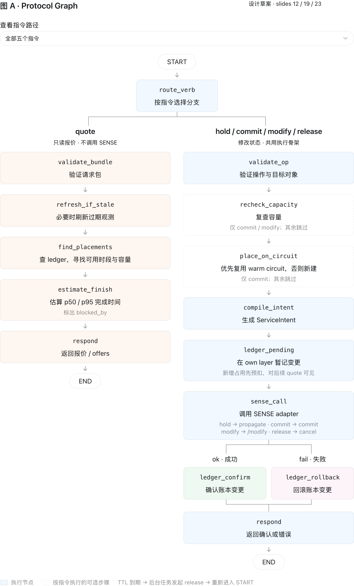
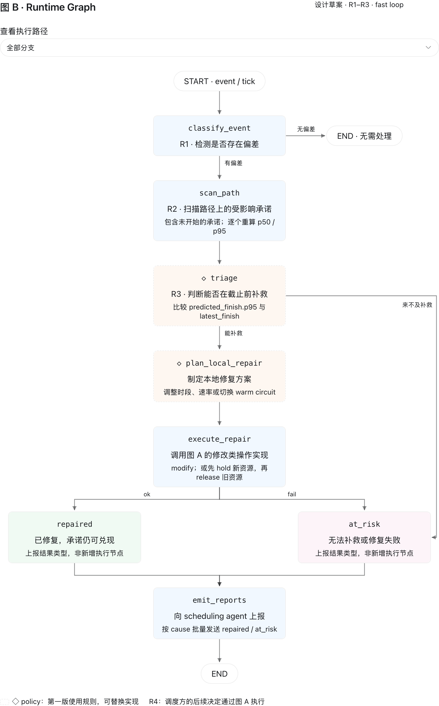
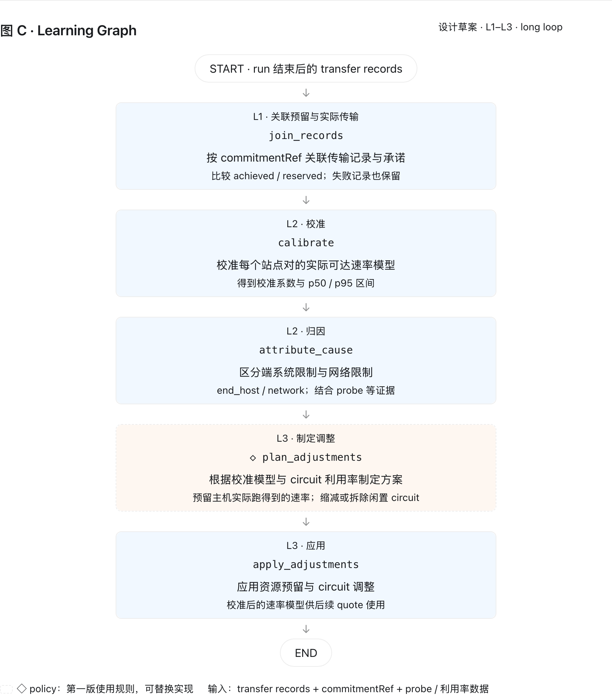

> 理解：resources/meetings/20261013_scinet_agent_implementation.md、resources/20261013_agentframework.md、resources/20261013_simpleQfor1013meeting.md、resources/20261014_networkagent.md
>
> 以及PPT：resources/slides/Agent Orchestration.pptx
>
> 然后我们开始基于LangGraph/LangChain，开始设计network agent。

**我同意先把 graph 定下来，但要补两件事，它们应该和 graph 一起定：**

1. **Agent 之间的消息类型要和 graph 同时锁定。** slides 6、8、17–20 已经定义了 TransferRequest、QuoteRequest/Response、hold_id、Commitment + EndpointBinding、repaired/at_risk、ServiceIntent、CapacitySample、ServiceState。它们决定了 graph 的输入输出，也决定了 state 里大部分字段的类型。
2. **要先说清楚哪些数据不放进 state。** capacity ledger、commitment/hold 表、circuit pool、校准模型是长期保存、所有请求共用的数据，不该放在某次执行的 state 里，否则并发预扣容量很难保证正确。这也和 slide 13 一致："The LLM never writes the ledger"。

下面是按 [Agent Orchestration.pptx](../resources/slides/Agent%20Orchestration.pptx) 整理的 network agent graph 设计。

---


## 1. 总体：三张图 + 一组共享存储

slide 12 把 network agent 分成 Planning、Runtime、Learning 三个阶段。三者的触发方式不同：Planning 由 scheduling agent 发来的指令触发，Runtime 由 telemetry 事件触发，Learning 在一次运行结束后批量触发。所以拆成三张图，比做成一张大图清楚：

```
 scheduling agent ──quote/hold/commit/modify/release──►  [A] Protocol Graph ──► 回复/offers/bindings
 telemetry agent  ──deviation event / tick──────────►  [B] Runtime Graph  ──► repaired / at_risk
 transfer records ──run 结束──────────────────────────►  [C] Learning Graph ──► 校准模型、circuit 调整
                                    │ 都读写（通过 context 注入，不放在 state 里）
                                    ▼
      CapacityLedger(observed/own) · CommitmentStore(holds+TTL) · CircuitPool · RateModel
      SenseAdapter（SENSE-O | NDT | Mininet mock，同一接口，对应 slide 8 的 swap point）

```

**slide 12 的 R4 不在图 B 里。** slide 20 写的是 "same verbs, no new protocol"：scheduling agent 做出决定后，会以 modify/hold/release 等指令重新进入图 A。

## 2. 图 A：Protocol Graph（slide 12 的 P1–P3 和全部五个指令）

图 A 只有两条分支：quote 只读、不调用 SENSE；hold/commit/modify/release 都会修改状态，共用一套骨架，各指令的差别放在节点内部处理。



[打开交互流程图（HTML）](../src/network_agent/protocol_graph_a.html)：选择 quote、hold、commit、modify 或 release，可单独查看该指令的实际路径。

- **从上往下读**：左侧 quote 报价后结束；右侧修改类指令在调用 SENSE 后，按成功或失败确认或回滚账本变更，再回复。
- **虚线框是按指令执行的可选步骤**：`recheck_capacity` 仅用于 commit / modify（slide 23）；`place_on_circuit` 仅用于 commit，优先复用 warm circuit，否则新建（slide 19）。其余指令跳过相应步骤。


| 节点                | 做什么                                                          | 出处                   |
| ----------------- | ------------------------------------------------------------ | -------------------- |
| `find_placements` | 在 ledger 里查可用空间，只做查表，不调用 SENSE                               | slide 19 P1、slide 23 |
| `estimate_finish` | 用校准后的速率算 p50/p95 完成时间，并标出 `blocked_by`（被自己的承诺还是外部流量占用）       | slide 19             |
| `ledger_pending`  | 先在 own layer 预扣，让下一次 quote 立即看到这部分占用                         | slide 19             |
| `sense_call`      | hold→propagate，commit→commit，modify→`/modify`，release→cancel | slide 8              |


**hold 的 TTL 到期不在图里处理。** 由 CommitmentStore 的后台任务发起一次 `verb=release` 调用，复用同一张图。

> 1. validate_bundle是在验证啥？
> 2. hold/commit/modify/release的validate是在验证啥？

**这两个 validate 都是我在设计草案里加的检查节点，属于普通 Python 规则，不是 LangGraph 内置功能。** PPT 给出了请求字段和五种指令的含义，但没有逐项定义这些校验。下面是我建议它们承担的职责。

**1.** `validate_bundle`**：检查这份报价请求是否完整、合法、可以进行计算**

`bundle` 是 scheduling agent 一次提交的一组传输需求。例如：

> 文件 A：ANL → ORNL，5 TB，要求在 09:00—10:00 内完成。  
> 文件 B：ORNL → UCR，1 TB，要求在 10:00—11:00 内完成。

建议检查：


| 检查内容                | 不合法的例子                                        |
| ------------------- | --------------------------------------------- |
| 必需字段是否齐全            | 缺少 `src`、`dst`、`bytes` 或时间窗                   |
| 字段类型与取值是否合理         | 数据量是负数、时间无法解析                                 |
| 时间窗是否自洽             | `earliest_start` 晚于 `latest_finish`           |
| bundle 内的传输 ID 是否重复 | 两条不同传输都叫 `transfer-001`                       |
| 请求模式是否合法            | `mode` 既不是 `all_or_nothing`，也不是 `best_subset` |


**通过校验，只表示“这个请求可以拿来计算报价”。** 是否真的有容量满足它，要交给后面的 `find_placements`、`estimate_finish` 判断。

例如，“5 TB 必须在一分钟内传完”可能是一个**格式合法但无法满足**的请求，不应仅因为困难就在这里判成格式错误。

**2.** `validate_op`**：检查这次操作针对的对象是否有效，以及当前是否允许这样操作**

它除了检查参数，还需要读取 hold/commitment 等已有记录。


| 指令          | 建议验证什么                                             | 例子                           |
| ----------- | -------------------------------------------------- | ---------------------------- |
| **hold**    | 所选 offer 能否识别、是否与原请求一致；TTL 是否合法；所选集合是否符合 bundle 模式 | 报价要求整组接受，却只选择其中一部分           |
| **commit**  | `hold_id` 是否存在、是否过期、是否处于可确认状态                      | hold 已因 TTL 到期释放，不能继续确认      |
| **modify**  | 目标 commitment 是否存在、状态是否允许修改、新参数是否自洽                | 要修改的 commitment 已结束；新时间窗前后颠倒 |
| **release** | 要释放的 hold/commitment 能否识别，调用方是否有权操作，以及如何处理重复释放     | 请求释放另一个 workflow 的预留         |


其中，**重复请求需要单独约定**。例如重复 commit 或 release，通常希望返回此前结果，而不是再次预扣或释放容量；这需要请求标识和存储层配合实现。

`validate_op` **与** `recheck_capacity` **的区别是：**

```
validate_op：
“这个 hold 还有效，允许执行 commit 吗？”
    ↓
recheck_capacity：
“现在的网络容量，还能兑现这份承诺吗？”
    ↓
执行预留／配置操作
```

校验通过之后，到真正写入账本时，仍需要事务或并发控制，避免多个请求同时使用同一份容量。

另外，**原图漏画了校验失败的出口**。这两种 validate 失败时，都应直接：

```
validate 失败 → respond（错误及原因）→ END
```

不会继续预扣账本或调用 SENSE。

## 3. 图 B：Runtime Graph（slide 12 的 R1–R3，即 slide 25 的 ① fast loop）



[打开图 B / 图 C 的 HTML 版](../src/network_agent/runtime_learning_graphs.html)：图 B 可以选择“无偏差”“修复成功”“修复失败”或“来不及补救”，单独查看对应路径。

图中的 `repaired` / `at_risk` 框用于标明上报结果类型，不是新增的执行节点；两者均由 `emit_reports` 发出。

- `scan_path`：列出这条路径上所有受影响的承诺，包括还没开始的，并逐个重算 p95（slide 20 R2）。
- `triage`：判断 p95 是否仍在 `latest_finish` 之前。
- `execute_repair`：通过共享库调用图 A 修改类指令的实现，例如 modify，或"先 hold 新的、再 release 旧的"（make-before-break）。


## 4. 图 C：Learning Graph（slide 20 的 L1–L3，即 ③ long loop）



[打开图 B / 图 C 的 HTML 版](../src/network_agent/runtime_learning_graphs.html)。图 C 从上往下依次展开 L1 记录关联、L2 校准与归因、L3 制定和应用调整；◇ 表示第一版使用规则实现的可替换 policy。

**ledger 刷新策略不做成图。** slide 23 的三种刷新动作（推进时间窗、重采旧时段、事件触发复查）先用一个定时调用的普通函数实现；以后要换策略时，再考虑升级成图。

> “**Calibrate and attribute**  
> Learn how fast each site pair really runs, as a range.  
> Then tell why it falls short: the hosts or the network.”
>
> 网络和主机区分之后有不同的应对方案吗？简单说明

**有，区分原因就是为了选择不同的补救措施。**


| 瓶颈位置       | 例子                           | 应对方向                                                   |
| ---------- | ---------------------------- | ------------------------------------------------------ |
| **主机／端系统** | 磁盘、CPU、NIC 或传输程序只能提供 10 Gbps | 调整实际可达速率模型，后续减少无效的带宽预留；通知 scheduling agent 考虑调整主机或任务安排 |
| **网络**     | 可用带宽下降、链路故障、路径拥塞             | 尝试调整预留带宽或时段、切换可用 circuit；仍无法按期完成时上报 `at_risk`          |


例如，**预留了 40 Gbps，实际只有 10 Gbps**：

- 如果主机最多只能输出 10 Gbps，再增加网络预留也没有帮助。
- 如果主机能输出 40 Gbps，但网络只能提供 10 Gbps，就应尝试修复网络侧资源或路径。

另外，**主机瓶颈也可能导致原定 deadline 无法兑现**，同样需要上报风险。归因决定“怎么补救”；能否按期完成决定“是否上报 `at_risk`”。

仅凭“实际速率低于预留速率”还不能确定原因，需要结合端系统指标、probes 和网络 telemetry。

> calibrate的作用？

**这一步是用过去“实际传了多快”的数据，修正以后对传输速度的预测。**

例如 ANL → ORNL：


| 项目          | 数值            |
| ----------- | ------------- |
| 网络预留速率      | 40 Gbps       |
| 多次传输实际达到的速率 | 通常约 20 Gbps   |
| 一个简单的校准系数   | 实际 / 预留 ≈ 0.5 |


那么，下一次生成 offer 时，就不能直接用 40 Gbps 预测完成时间，而应考虑**实际可能只有约 20 Gbps**。

以传输 1 TB 为例，忽略其他开销：

```
按 40 Gbps 预测：约 200 秒
按 20 Gbps 预测：约 400 秒
```

这样可以避免给 scheduling agent 一个过于乐观的完成时间。**它修正的是预测模型，网络的物理容量不会因此改变。** 实际模型也可以考虑文件大小、时段和并发情况，未必始终使用固定的 0.5 系数。

图中的 **p50 / p95** 写得有些含糊。这里最终希望后续 quote 给出完成时间的不确定性：

- **p50 完成时间**：预测有约 50% 的传输能在此之前完成。
- **p95 完成时间**：预测有约 95% 的传输能在此之前完成，用于更保守地判断 deadline。

这一步通常通过统计或回归模型实现。后面的 `attribute_cause` 再分析：实际速度低，是主机限制还是网络限制。

> 逻辑是不是有问题，这一步既然修正了模型，下一步却是`attribute_cause`，下一步如果找到问题了不就修复了吗，换主机的换主机，换circuit的换circuit，矫正的意义是？

**你的质疑成立：如果把故障期间的低速直接校准成“今后的正常速度”，接着又把故障修好了，这个模型就会过时。当前图 C 没有表达这层区别。**

不过，`attribute_cause` 只是**判断原因**，修复还需要后续动作，也可能暂时无法完成。例如换主机需要 scheduling agent 调整任务安排。

校准是否有意义，要看差距来自什么：


| 情况                                        | 应该怎么处理                              |
| ----------------------------------------- | ----------------------------------- |
| **临时网络故障**：平时能跑 36 Gbps，故障时降到 10，修复后恢复 36 | 把故障样本标记出来；不能把正常速率永久下调到 10           |
| **长期主机限制**：预留 40 Gbps，但当前主机只能输出 20        | 在主机更换或优化前，模型需要按这个限制预测；换主机后重新测量、更新模型 |
| **正常性能差距**：预留 40 Gbps，健康状态下通常达到 36，且存在波动  | 校准仍有价值，用真实表现预测完成时间和不确定性             |


所以，**“修复”负责改变系统，“校准”负责准确描述当前系统能做到什么。** 修复成功后，模型应跟着新观测更新。

我会把图 C 的逻辑改成：

```
关联传输记录
    ↓
结合已有模型、telemetry 和 probes 归因
    ↓
区分：健康运行 / 临时故障 / 持续性限制
    ↓
按运行条件校准速率模型
    ↓
制定并应用长期调整
    ↓
后续观测验证效果，再更新模型
```

**关键改动是让归因结果参与校准。** 故障记录仍然保留，但要带上状态标签；不能把修复前后、不同主机或不同 circuit 的表现混成一个固定折扣系数。紧急故障的修复则主要由图 B 处理。


## 5. State 草案（字段来自 slides）

```python
class ProtocolState(TypedDict):
    verb: Literal["quote","hold","commit","modify","release"]
    msg: QuoteRequest | HoldRequest | CommitRequest | ModifyRequest | ReleaseRequest
    placements: dict[str, list[Placement]]        # transfer_id → 候选位置
    offers: dict[str, list[Offer]]                # {start, rate_profile, qos_class, p50/p95, blocked_by}
    target: Hold | Commitment | None
    circuit: CircuitChoice | None                 # 复用 warm circuit / 新建
    intent: ServiceIntent | None
    ledger_txn: str | None                        # 预扣事务 id，用于 confirm / rollback
    sense_result: SenseResult | None
    response: QuoteResponse | HoldAck | CommitAck | Ack | Error
    provenance: Annotated[list[Provenance], add]  # slide 12："every number carries its source"

class RuntimeState(TypedDict):
    event: DeviationEvent                         # link_down | capacity_drop | probe | slow_transfer
    affected: list[AffectedCommitment]            # commitment_id, p50/p95, latest_finish, slack
    repairs: list[RepairAction]
    reports: list[Repaired | AtRisk]              # 按 cause 批量上报
    provenance: Annotated[list[Provenance], add]

class LearningState(TypedDict):
    records: list[TransferRecord]
    samples: list[CalibSample]                    # ratio = achieved / reserved
    rate_updates: dict[PairKey, RateModel]
    causes: dict[str, Literal["end_host","network","unknown"]]
    adjustments: list[Adjustment]

@dataclass
class NetAgentContext:  # 用 LangGraph runtime context 注入，不是 state
    ledger: CapacityLedger; commitments: CommitmentStore; circuits: CircuitPool
    rates: RateModelStore; sense: SenseAdapter; telemetry: TelemetryClient
    policies: Policies  # triage / repair / adjust / refresh，先用规则实现，接口可替换

```


## 6. 怎么划分节点，LLM 放在哪

**划分规则：** 一个步骤满足以下任一条件才单独作为节点，否则就是 `src/lib` 里的普通函数：

- 要访问不同的外部系统（ledger、SENSE 或 telemetry）；
- 是一个有分支的决策点；
- 将来可能换成别的实现（规则换策略，或换 LLM）。

**LLM 的位置：** 第一版不放 LLM 节点。图中标 ◇ 的节点（`triage`、`plan_local_repair`、`plan_adjustments`）就是 slide 13 里 "Make trade-offs ?" 那一类，先放在可替换的 policy 接口后面用规则实现，以后再比较 LLM 能不能做得更好。所有数字计算的节点永远不用 LLM。

## 7. 需要你决定的一点

**quote → hold → commit 怎么跨调用串起来？**

- **我推荐：每个指令独立调用一次图A。** 状态的事实都保存在 CommitmentStore 里，hold_id 就是关联键。
- **另一种做法：每个 bundle 对应一条 thread，用** `interrupt()` **等待 scheduling agent 选择。**

推荐前者的原因：scheduling agent 可能一直不回来，TTL 无论如何都要由存储层处理；`interrupt` 主要是为"等人类确认"设计的，不适合 agent 之间的 RPC；而且前者更贴近 slides 里的 RPC 式协议。

## 8. 两个附带问题

- **slides 里同一个上报事件有两个名字。** slide 3/6 叫 "runtime schedule failure"，slide 12/18/20/25 叫 `at_risk`。定 schema 之前要统一，我上面暂时用的是 `at_risk`。
- **计划稿还停在 Exp2。** [current_experiment_plan.md](../docs/current_experiment_plan.md) 写的仍是 Exp2（SENSE intent harmonize）。转向 network agent 实现等于换实验，需要你来决定。本轮我没有改任何文件。

**建议的下一步：** graph 一旦确认，先把第 5 节和第 8 节提到的消息类型写成 pydantic schema 放进 `src/lib`；然后用 Mininet 或 mock 的 SenseAdapter，加上 1000genome workflow 里的跨站点传输，跑通图 A 的 quote → hold → commit 规则版闭环。

---

> 根据你现在的思考，network agent除了**Over-provisioning 与 offer 生成和修复决策中的本地修复这两个地方可以用到LLM，还有别的地方可以用到LLM吗**

**有。我认为最值得考虑的新增位置是“诊断原因”和“决定下一步查什么”。** 另外还有观测刷新策略、长期 circuit 管理，以及面向人的解释。

不过先清一个边界：**over-provisioning 的校准数值、offer 的容量与完成时间计算，仍应交给统计模型或求解算法。** LLM 可以提出策略或候选方案，再由程序验证。这个边界也符合 [slides 第 13 页](/Users/lxzhong/Documents/GitHub/genesis_scinet/resources/slides/Agent Orchestration.pptx) 的设计。

下面这些是我认为值得考虑的候选位置，尚未验证 LLM 是否比规则更好：


| 位置                                      | LLM 可以做什么                                 | 简单例子                                    |
| --------------------------------------- | ----------------------------------------- | --------------------------------------- |
| **故障诊断与归因**，对应 `attribute_cause`        | 综合不同来源的日志、配置、telemetry 和历史事件，提出有证据支持的原因假设 | “网络预留正常，但发送端磁盘读取速率下降，更可能是主机侧瓶颈。”        |
| **探测规划**，目前没有单独画成节点                     | 根据现有证据，选择下一项查询或 probe，逐步排除原因              | “当前无法区分主机与网络，先查询 NIC 和磁盘指标，再决定是否做路径探测。” |
| **观测刷新策略**                              | 在查询开销和信息过期风险之间选择刷新重点                      | “即将执行且容量波动大的站点对多刷新；远期、稳定的时段少刷新。”        |
| **长期 circuit 管理**，对应 `plan_adjustments` | 综合复用机会、配置耗时、资源占用和运行历史，建议保留、缩容或拆除          | “这条 circuit 当前空闲，但近期反复被使用，建议暂时保持 warm。” |


其中，**诊断与探测规划可以形成一个小循环**：

```
发现传输变慢
    ↓
LLM：根据已有证据，列出可能原因
    ↓
LLM：选择一个最有助于区分原因的查询／probe
    ↓
程序执行工具，获得真实结果
    ↓
更新判断，再决定是否继续调查或交给修复流程
```

这里 LLM 负责组织调查，测量结果、容量计算和操作执行由工具提供。**“提出原因假设”不能直接等同于“已经证明原因”。**

此外，面向人的功能也适合 LLM，例如解释报价为什么被拒绝、把一次 `at_risk` 事件整理成可读报告、向管理员追问缺失信息。但你们已经使用结构化 agent 协议，内部消息不需要再绕一遍自然语言。

**如果只增加一个 LLM 切入点，我会选“有证据的诊断 + 下一步探测选择”。** 它能处理异构信息和不确定的调查路径，也容易设定评价指标：是否定位正确、用了多少次探测、花了多长时间。

