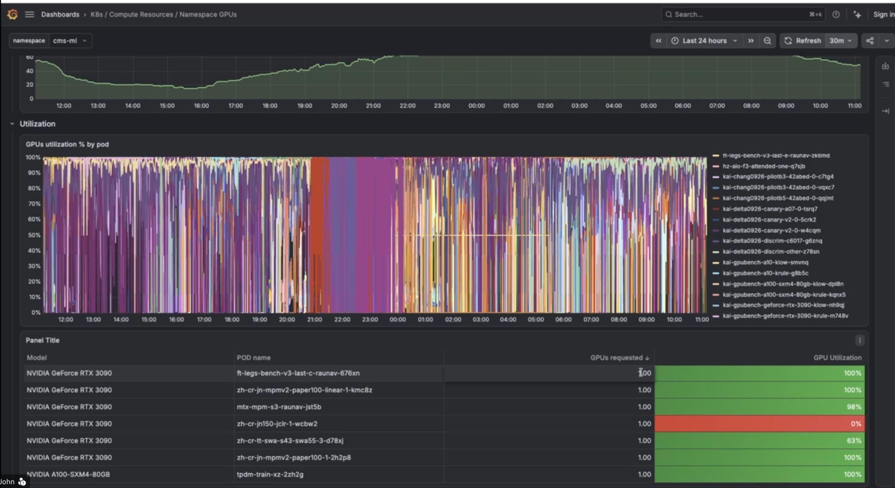
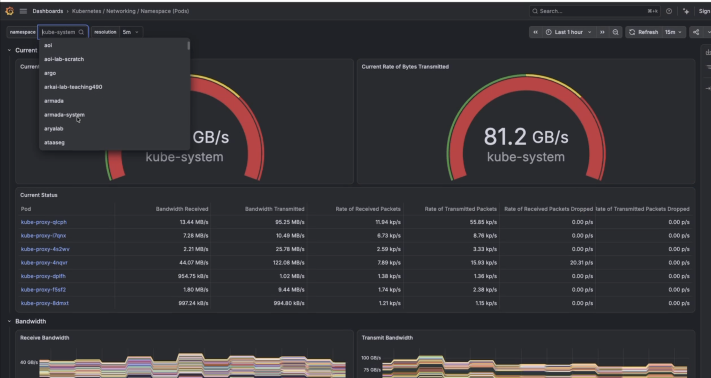
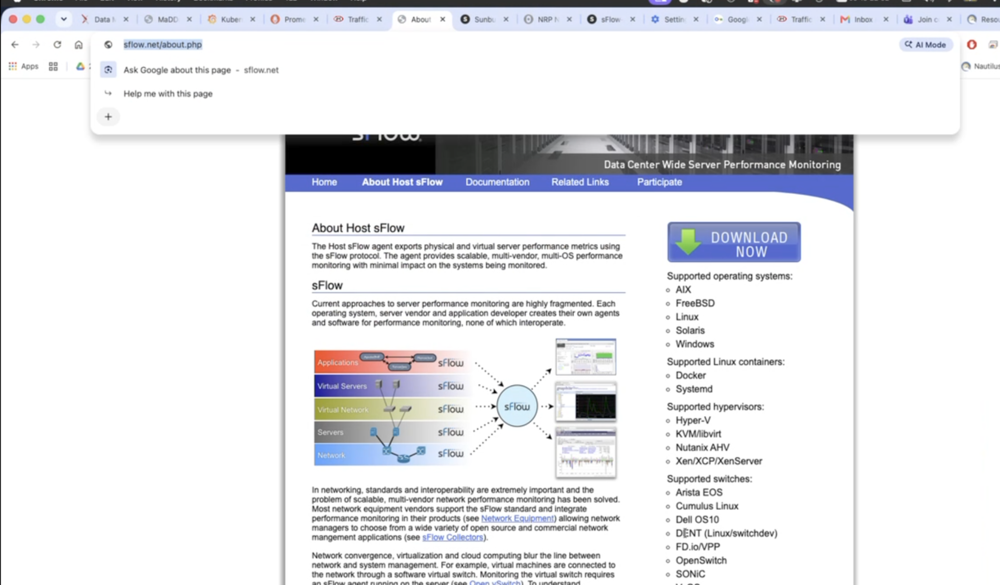
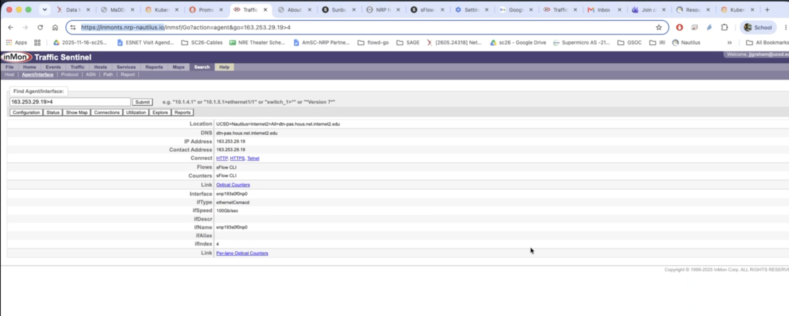
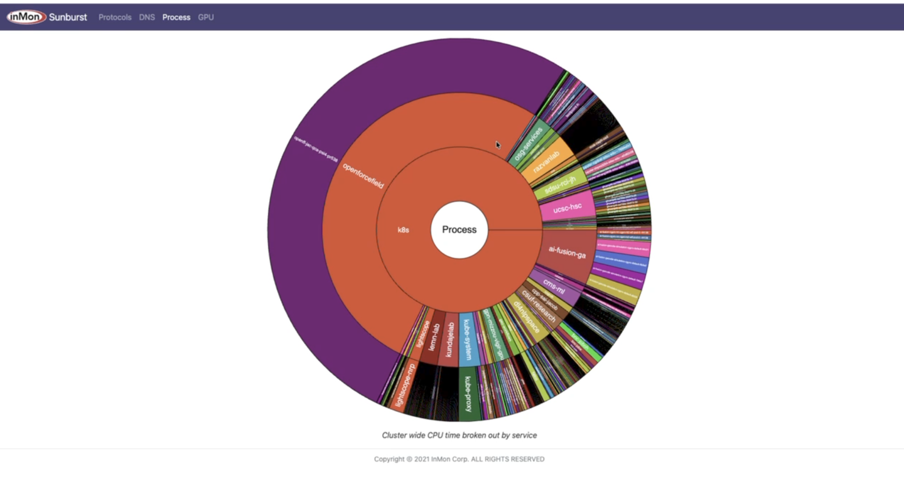
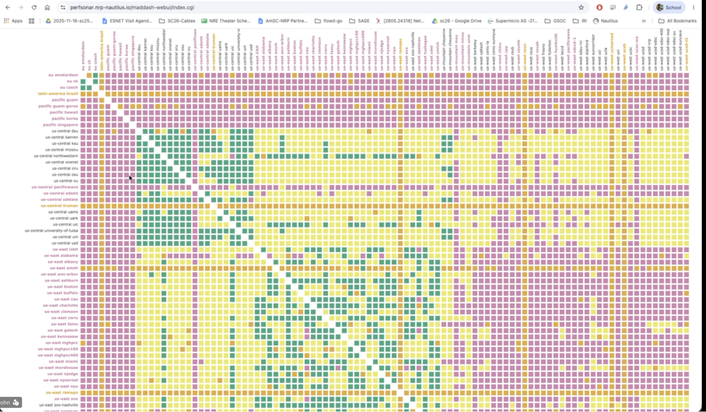
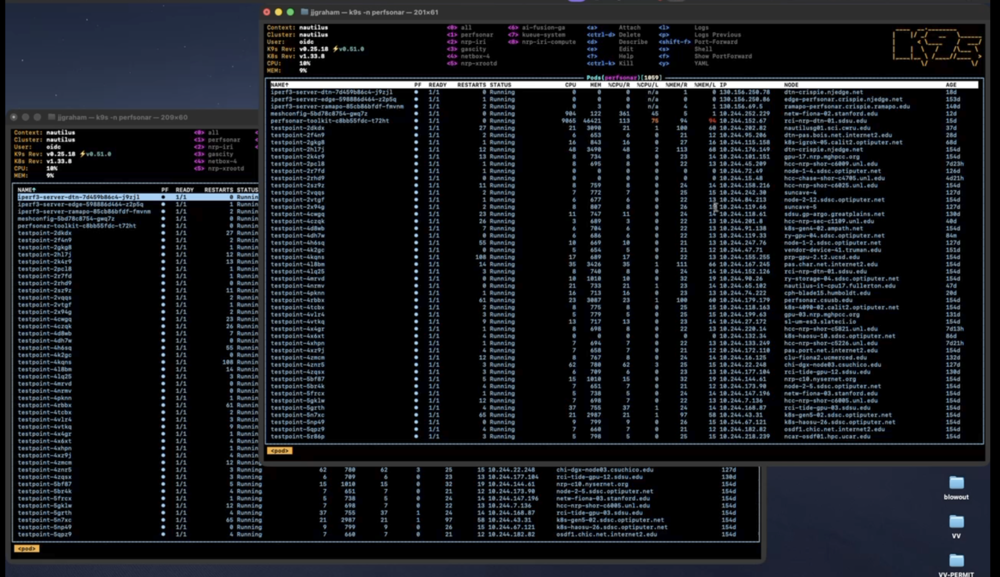
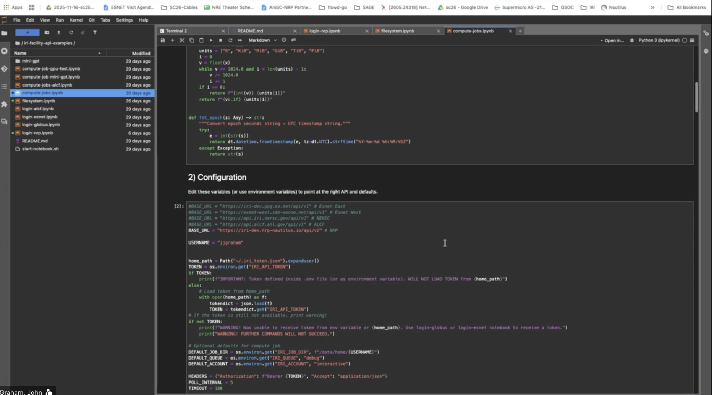
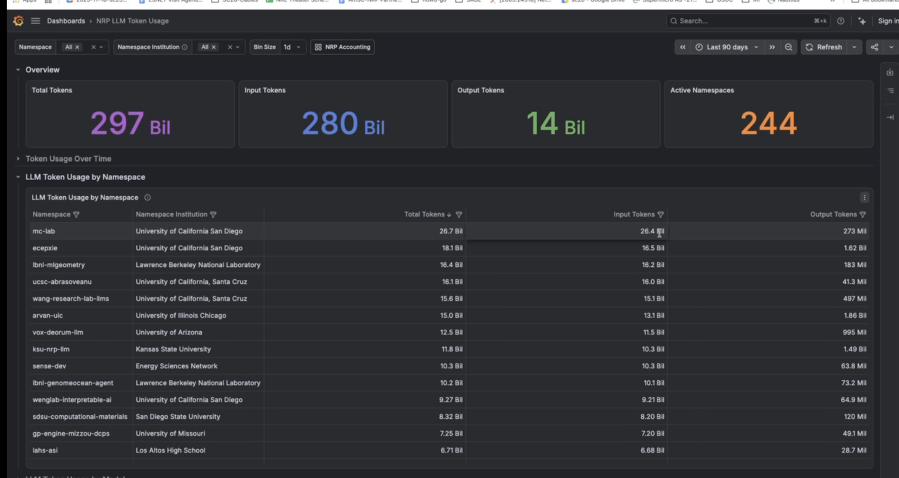

# 2026-09-29 SciNet 会议：John 介绍 NRP 资源、监测与跨站点实验能力

> **日期**：2026-09-29，依据用户指定的会议记录文件名补录。
>
> **主讲与参会信息**：John Graham（用户提供的截图显示姓名）；问答中出现 Harvey、KK、Aaron 等称呼，转录不足以恢复完整参会名单及全部发言归属。
>
> **材料与可靠性**：用户提供的英文自动转录、七个链接及九张展示截图。转录无 speaker labels 和时间戳，术语、人名、型号与数字有误识别。本文按议题整理，平台能力及使用规则均记为会上说法，不将其视为已经验证的项目结论。原文完整保留在附录 B。
>
> **截图口径**：截图为用户随补录提供的展示材料，拍摄时刻未另行核对；图中数值仅代表画面快照。九张图保存在 `../imgs/`，文件后缀顺序对应用户发送顺序，正文按相关议题引用。链接现有页面不用于追溯替换会上模型清单、容量或访问政策。

## 核心摘要

John 介绍 National Research Platform（NRP / Nautilus）的资源发现、节点预留、监测数据、网络测量、跨域连接和交互式开发环境。**NRP 被提出为 SciNet 原型与分布式实验可以先行使用的平台**：可以先选择连接较好、使用较少的 Internet2 节点，不必从大型 GPU 预留开始，再逐步考虑接入国家实验室设施。

对网络与 telemetry 工作，会上展示了 **Grafana / Prometheus、Host sFlow / inMon Traffic Sentinel / sFlow-RT，以及 perfSONAR / MaDDash**。它们分别提供资源与 pod 指标、流量及接口观测、端到端主动测量等信息；John 表示这些工具有 API，但本次未逐项审计接口、权限或数据保留期。

讨论也暴露了几处不能直接画等号的边界：**节点预留不等于骨干带宽预留；任务事后起止记录不等于运行前可预测的时间槽；一个全球 Kubernetes cluster 不等于多个机构独立 clusters 的协同环境。** 此外，NRP 接入国家实验室或商业云的网络路径，不会自动赋予这些设施的计算 allocation。

## 一 资源发现、按需运行与节点预留

### 查看与选择资源

John 展示 NRP 的 available resources 页面，称资源列表约每 10 分钟更新，可查看空闲 GPU、CPU、内存、网络能力、架构、region/zone、节点 taints 等信息。

在 Kubernetes 中，可按 CPU 数量、内存、临时磁盘、GPU 等条件请求资源，并按地理区域、具体 campus / data center、CPU 架构等选择节点。页面也展示网络接口能力，例如 10G、100G；会上现场筛选有未成功的情况，不能据演示认定全部筛选语法已经明确。

对于 RDMA，John 表示 InfiniBand 系统较少，对 RoCE v2 的覆盖也用了不确定措辞。**本次没有验证指定 GPU、网卡与 RDMA 组合一定可被申请到。**

### Ad hoc 与 reservation 的区别

John 将通常的 NRP 使用描述为 first come, first served，不要求先拿到传统 HPC allocation：可先提交 pod/job，资源可用时由 Kubernetes 启动。较长时间或大型 GPU 需求，可以向 NRP 管理团队申请节点 reservation，讨论开始时间与持续时间。

Reservation 通过节点 taint 及相应 toleration 控制使用者范围，需要人工协调；页面有 reservation 状态，但会上没有提供自动计算“何时能获得任意一组资源”的完整机制或 API。

平台还运行 ATLAS、LIGO、Open Science Grid 等低优先级负载。按 John 的介绍，正常请求可使相关低优先级容器退出并释放资源；这些负载用于填补闲置容量。**这不意味着所有 NRP 工作负载都能随时被任意用户抢占。**

## 二 GPU 利用率与资源使用监测

John 展示按 namespace、pod 查看 GPU 请求量和利用率的 Grafana dashboard，可切换时间范围、刷新频率，查看不同型号 GPU 上的任务。

John 强调，平台会观察用户和 namespace 的资源利用情况；长期申请 GPU 却不使用，可能影响继续启动任务。会上没有给出具体判定阈值或处罚规则。

图 2 的利用率曲线和表格说明可以下钻到 pod，而非只能看整个集群的总量。截图不构成本项目测得的性能结果，也不能仅据画面中短时低利用率判定某个用户浪费资源。

## 三 网络指标：Grafana 与 Prometheus

John 展示按 namespace 和 pod 查看接收/发送带宽、包速率、丢包及错误等指标，可以选择单个或多个 pods 查看时间序列。

图 3 中可见 `kube-system` 的发送速率为 **81.2 GB/s**，属于所选范围的 dashboard 快照；不能将其解释为一条物理链路的能力或可供新 transfer 使用的带宽。读取时尤其要区分页面的 **GB/s** 与网络配置中常见的 **Gbps**。

John 表示，Grafana 使用到的指标可以经 Prometheus 直接查询。这说明存在指标数据入口，但没有据此确认监测项能直接回答“某条路径未来时段的可用容量”。后者仍涉及指标对象、聚合方式、占用和预留信息的对应关系。

## 四 流量、接口与光模块观测：sFlow 工具链

### Host sFlow 与 inMon Traffic Sentinel

John 介绍，NRP 从部分骨干路由器采集 sFlow，同时在 hosts 上运行 Host sFlow（`hsflowd`），使流量信息能够按 Kubernetes namespace 和 pod 分解。会上提及 CENIC、Internet2 等网络来源，具体覆盖节点与链路未列出完整清单。

在 Traffic Sentinel 中，John 演示了站点、主机与接口下钻，并展示接口的 optical counters，包括收发光功率、bias 等观测。问答也提到 SNMP 与 sFlow 两种信息来源。

图 7 显示所选接口 `ifSpeed` 为 **100 Gb/sec**，并有 optics 与 per-lane optical counters 链接；这只说明被选接口的展示内容，不代表所有 NRP 节点都具备同样接口或全部计数器。

### sFlow-RT 与自定义 dashboard

John 还展示了实时 sunburst，可按进程、namespace、域名、GPU 或协议等角度观察集群使用情况。演示时 Open Force Field 占据较大 CPU 使用份额；John 将其描述为利用空闲资源的低优先级工作负载。

John 表示，可以为实验所用链路建立专门 dashboard，也可以用 Observable notebooks 自行组织监测可视化。会上对某个端口对应何种服务有即时猜测和纠正，本文不将端口与应用的对应关系写成定论。

## 五 主动测量：perfSONAR、MaDDash 与测试点

### 已部署的测量与可执行的测试

John 展示 perfSONAR / MaDDash 的区域间矩阵，可下钻到节点，查看 delay、loss 等端到端测量。他描述了物理 host 与容器 overlay 两种测量环境；具体测试点名称与命名规则需结合部署核对。

John 表示，可以获准在指定 testpoint pods 中运行测试，通过 Kubernetes exec 启动一侧 server、另一侧 client，并将结果返回控制端。演示使用终端管理界面进入不同节点，尝试了 iperf/iperf3 及另一种测量工具。

这些是平台可提供的测试入口，**本次会议没有形成一组经过复核的吞吐实验结果**。部分现场命令遇到端口已占用、连接或工具使用问题。

### 主动测量的开销争议

有参会者指出，iperf 为测量带宽本身会消耗带宽，询问能否采用侵入性更低的 available-bandwidth estimation。另一位参会者进一步澄清，关心的是**可用带宽估计**，而不仅是把链路打满后的最大吞吐。

John 回答，平台持续运行测量，多数时候结果良好；若预留了节点，节点上的其他流量也可以受到限制。但提问者指出，**预留节点或其网卡不等于预留核心骨干网络带宽**。本次没有给出双方认可的低开销测量方案，不能把该问题记为已解决。

随后讨论到单流性能限制与多并行流测试，并尝试另一种高带宽工具；该工具在转录中反复出现为 `ether` 等，疑似 **ethr**，但未核对命令或二进制名称，故不恢复可直接执行的命令。

## 六 多站点网络连接与独立 clusters 的区别

### NRP 的全球单集群

John 说明，NRP 运行一个跨地区的 Kubernetes cluster，远端 containers 仍可处于同一 namespace。Overlay 连接也因此跨越地理站点，而不只是单一数据中心内通信。

参会者进一步提出 SciNet 的需求：希望模拟多个国家实验室**各自拥有独立 Kubernetes cluster**，再研究跨 cluster 的资源分配与 workflow orchestration。单一全球 cluster 可以承载分布式任务，但不能自动代表这种管理边界。

John 提及 Admiralty 等 federation 方式，以及用 Terraform 建立虚拟机 / 小型 cluster 的思路。有关 VM、kubelet 与“单节点 cluster”的表述在转录中不够精确，本次没有确认可复用的多独立集群部署方案。

### Multus、SENSE 与跨域 L2/L3

John 介绍，可用 Multus 接口和相应 VLAN 配置连接 layer-2 paths；不同 clusters 不必共享控制平面，也可通过配置好的网络路径通信。

会上提到由 Mohammad 开发的 Kubernetes operator，可以衔接 SENSE，以及 FABRIC、FabFed 等连接方式；开发者全名与组件版本未明确。SENSE 可进一步通过 OSCARS、Internet2 AL2S 等服务编排跨域路径。

John 区分了不同底层网络的能力：ESnet 路径与 Internet2 AL2S 的 QoS 条件不同，部分情况下需在 host 侧用流量整形 / pacing 控制发送速率。**“路径已建立”与“取得可保证的带宽”应分别核对。**

Layer-2 overlay 被描述为适合保持一段时间的连接，多 flow 的管理另在上层进行；转录中上层组件名称不清，本文不补全。

## 七 跨站点网络实验的资源与时间语义

有参会者用具体需求提问：希望获得四个有适当计算资源、通过 100G 链路互联的节点，使用两周；若暂不可用，希望知道可用时段并收到通知。

John 建议优先使用 Internet2 backbone 上的 NRP 节点，称其连接能力较好、适合网络实验；可以按 zone 选择节点，并由团队协助配置 layer-2 paths。后续在培训、权限及相关网络方认可后，用户 namespace 可获相应操作权限。会上没有核对节点数量、任意节点组合的路径保障或权限审批时间。

另一位参会者追问：workflow planning 需要**运行前知道任务预计持续多久、可用时段的开始与结束，以及怎样安排多个任务**。John 回答 Kubernetes Job 可以尽早启动，完成后保留日志并查看 start/stop time。

这提供了事后执行记录，**并未直接回答运行前的 duration prediction、未来时间槽规划与组合 reservation 问题**。本次没有确定一个满足上述需求的调度或预留系统。

## 八 IRI API、JupyterHub 与工作流示例

### 先在 NRP 验证，再扩展到外部设施

John 介绍 American Science Cloud / IRI API 的方向：在有相应 allocations 和权限的情况下，编排 compute、storage 及两端网络连接。NRP 上有相关 API 与 notebooks，可先在 NRP 验证 workflow，再考虑接入国家实验室。

他建议先选 Internet2 节点开展原型，不必一开始申请大型预留，再逐步加入有 allocation 的外部设施。这是平台使用建议，**本次没有正式选定本组第一个实验或获准执行任何资源申请。**

### JupyterHub 与 notebook 演示

John 演示 JupyterHub：经 federated identity 登录后，可选择 region、CPU、GPU、RAM、镜像和架构，挂载持久化 volumes，启动 notebook 或带图形界面的环境。也提到 Jupyter AI 和自定义、持续运行的 JupyterHub。

在 IRI facility API 示例中，他展示了登录、文件读写/清理、提交 compute jobs、GPU 测试等 notebooks，可切换 NRP、NERSC、ALCF 和 ESnet 相关 API endpoints。

图 9 可见 NRP `/api/v2` 与其他设施 `/api/v1` 的配置示例，**不证明各端点的 API 版本、权限或功能完全相同**。这些旧示例在现场运行时出现问题；John 提到近期 worker logging 相关变更可能有关，因此不能将演示记为端到端全部成功。

## 九 LLM 服务与 token 使用情况

John 展示 NRP 托管 LLM 的状态与模型页面，介绍按输入类型、reasoning、tool calling 等能力选择模型，也提及 MCP server。模型会评估、升级和退役；用户也可申请 GPU 自行运行模型。

图 1 选择 **Last 90 days**，画面显示 Total Tokens 约 **297 Bil**、Input Tokens **280 Bil**、Output Tokens **14 Bil**、Active Namespaces **244**。这些是显示值，不据四舍五入后的卡片值重算或修改总数。John 口头另称当时每天约服务 60 亿 tokens；两者统计时间范围不同，不应混用。

会上列举的具体模型名、代际和大型 GPU 设备安排转写不稳定，本文不据此恢复历史模型清单或未来供给承诺。准确型号、可用时间和服务状态应回查当时展示材料；当前模型页面只作为后续访问入口。

## 十 登录、namespace、存储与外部 allocation

### 身份与组内使用

John 介绍通过 CILogon / 校园 SSO 登录；用户先完成首次登录，namespace admin 再将其加入相应 namespace。若机构身份暂未获准，可联系 John 协助添加；对合作方企业身份，也讨论了其他 identity providers，并非限定必须使用校园账号。

组内可指定 namespace admin，管理用户、volumes 和多个 namespaces。按会上说明，同一 namespace 可便于共享存储；也可以按用户或小组拆分。John 还提及共享文件系统和 S3，但转录中的文件系统名称不清，本文不恢复具体产品名，也不将性能比较当作已测结论。

### NRP 不能代发国家实验室或其他云的 allocation

问答澄清了一个方向性误解：NRP 的部分资源可以通过外部 allocation 项目分配，但**这不意味着拿到 NRP 账号就获得那个项目的其他资源**。转录将该项目写为 `NAR`、`N` 等，按 AI 资源 allocation 与商业云上下文暂理解为 **NAIRR**，正式名称仍待核对。

商业云资源也需要相应 allocation（例如讨论中提及 CloudBank 或其他来源）。在已有权限后，SENSE / AL2S 等可帮助连接网络；仅建立 layer-2 path 不会共享 Kubernetes namespace，也不会自动把外部节点纳入 NRP cluster。

对于国家实验室资源，John 表示相关跨设施 allocation 及连接还有待实践，并提及 Daniel Diaz 正与 David Martin 等人沟通小规模、director-level allocation 的流程和限制。**这是正在推进的工作，不是已经验证完成的 NRP—国家实验室联合实验。**

## 十一 FPGA / P4 遥测与多地点实验

John 介绍 NRP 有 Xilinx Alveo U55C 一类 FPGA，运行 ESnet SmartNIC stack，可用于 P4 网络遥测；另提到 Tofino 2、400G Edgecore P4 switch，以及 FABRIC 上可衔接的设备。具体型号、端口速率和可分配范围仍需核对，不能只依转录建立设备清单。

KK 关心的不只是是否有 FPGA，而是**在自己的实验中能否取得相应网络测量数据**，并希望尽量在一个平台完成，而不是为此同时使用 NRP 和 FABRIC。

John 表示本地 FPGA 资源集中在一个地点，也可通过横跨广域网的 layer-2 loop 拉长路径。KK 澄清，这并非主要目标：真正需要的是**两三个地理上分离的 sites、独立 clusters，以及分布式实验的资源分配和管理**。

John 最后提到 Texas 还有一个具备 P4 / FPGA 能力的 cluster，但当时记不起站点名，表示查到后在下次会议补充。该站点尚未在本次材料中确定。

## 十二 会上提出的后续事项与未决问题

| 事项 | 负责人或提出者 | 状态与边界 |
| --- | --- | --- |
| 遇到 dashboard / 身份访问问题时，联系协助开放机构或用户访问 | John 提供支持 | 未在会议中实际办理全部参会者权限 |
| 选择 Internet2 节点作为网络原型的起点 | John 建议 | 尚未选定本组拓扑、实验或使用时段 |
| 提供网络测量入口、必要时协助配置 L2 paths 和权限培训 | John / 平台团队介绍可支持 | 测试点权限与网络编排权限需分别确认 |
| 研究国家实验室小规模 allocation 的流程与限制 | 会上提及 Daniel Diaz 等人正在推进 | 本次未获得 allocation，也未完成跨设施实测 |
| 查询 Texas P4 / FPGA cluster 的站点名称 | John 表示会后查询 | 本次未给出名称；拟下次会议补充 |

仍未回答的关键问题包括：如何在运行前预测任务持续时间并规划时间槽；如何同时表达节点与端到端网络资源需求；如何低开销估计可用带宽；如何搭出多个独立管理的 clusters；各监测 API 的实际字段、采样周期、历史范围与访问权限是什么。

## 十三 用户补充的工具入口

以下保留用户提供的七个 URL。用途依据会议及截图整理，**不表示当前页面可以匿名访问，也不将补录时的页面内容作为 2026-09-29 的历史快照**。

| 入口 | 会上用途 |
| --- | --- |
| [inMon Traffic Sentinel](https://inmonts.nrp-nautilus.io/) | 流量、主机/接口下钻、链路与光模块观测 |
| [NRP Nautilus Observable notebooks](https://observablehq.com/@nrp-nautilus) | 自定义资源和监测可视化 |
| [NRP Grafana](https://grafana.nrp-nautilus.io/) | Namespace、pod、GPU 和网络等 dashboards |
| [NRP Prometheus](https://prometheus.nrp-nautilus.io/) | 直接查询时序指标 |
| [NRP Available resources](https://nrp.ai/viz/resources/) | 查看可用节点、GPU、CPU 与资源条件 |
| [NRP Managed LLM — Available Models](https://nrp.ai/documentation/userdocs/ai/llm-managed/models/) | 模型及能力说明；清单会变化 |
| [NRP West JupyterHub 登录](https://jupyterhub-west.nrp-nautilus.io/hub/login) | 启动交互式 notebooks 与开发环境 |

截图中另外可读到 [perfSONAR MaDDash](https://perfsonar.nrp-nautilus.io/maddash-webui/index.cgi) 和 [About Host sFlow](https://sflow.net/about.php) 的地址；这两项来自截图，区别于上述用户单独提供的链接。

## 附录 A 转写存疑与记录边界

| 转写 / 项目 | 本文处理 |
| --- | --- |
| `Cubernettis` 等 | 按语境整理为 Kubernetes |
| `personar`、`Perf Son`、`mad dash` | 结合截图整理为 perfSONAR / MaDDash |
| `in Mont`、`traffic sentinel`、`HS flow D` | 结合截图整理为 inMon Traffic Sentinel、Host sFlow / hsflowd |
| `Maltus`、`Veland` | 按多接口和 L2 语境整理为 Multus、VLAN |
| `A to us`、`ALS` 等 | 按 Internet2 路径编排语境整理为 AL2S；未核对部署细节 |
| `ether` 等测量工具 | 疑似 ethr，待核对，不提供恢复后的命令 |
| `NAR`、`N` 等 allocation 项目名 | 暂按上下文理解为 NAIRR，需回查正式名称 |
| 模型名、GPU 型号、FPGA / switch 部分参数 | 误识别明显处不补全；保留原文供回听 |
| 人名及发言归属 | John Graham 有截图支持；其余不强行补全完整姓名或参会名单 |
| 开场建筑、小说与出版年份闲谈 | 正文不据此确认外部事实，原文保留 |

## 附录 B 原始转录

以下完整保留用户提供的转录，不修正术语、语法、数字或发言归属；包含开场闲谈和末尾转录工具反馈提示。

<!-- BEGIN RAW TRANSCRIPT -->
What is this fancy building behind you?

That is the Geisel library at UC San Diego built in 1960. The actually most of the lib is underground, but that is basically the centerpiece of our campus. Very uh popular destination.

It's also the uh the location of my favorite science fiction novel.

It's called uh rainbow's end by Werner Vinji and it was a written about the UCSD campus in December of 2025 and so it was written back in the 80s but it covers the topics of augmented reality and AI and yeah Werner just nails it. A fabulous book.

So I just wanted to say that in Paris, a built library, a very fancy building, you know, all glass, actually there are kind of a corner, so they look like four books on the corner and then they realize that putting rare books in those building, which have a lot of glass, that's pretty bad for the books because there is too much light.

And so that's and so that after they put it on the ground where there is much less light on this better. . Most of it's underground.

So who is the host of today's meeting?

I suspect Kiran is not going to join, right?

I thought she was going to hop in to begin and uh maybe start a recording.

I'm going to do a presentation of all the uh measuring and monitoring tools, but I wanted to know the host because it would be good to have someone start the recording.

Yeah I can't it looks like I'm not allowed.

That might be difficult.

Hi hi aaron. . We cannot hear you, Aaron. So Aaron is a new addition to the project.

Say something I'd let's see if we can hear you do you have the ability to start recording it's grayed out for me under record and transcribed.

Oh, I can do it.

I can do it.

Oh no, no I cannot.

Sorry.

Otter will record a little Aaron Aaron was able to Perfect...

All right, we waiting for anyone else or should I get started?

You should get started.

Okay.

Let's see if I can share my screen.

Yes.

Okay. Um So yeah, I'm gonna cover um the National Research platform measuring and monitoring uh tools and the uh if we just go to NRp. There's all kinds of dash boards available um I think I've uh showed the available resources uh so this is updated every 10 minutes so if if you're looking for some type of uh like a uh 10 GPUs you can get a listing of all the ones and GPUs free we can we can sort by the number of free GPs so actually this is including an A hundreds if I put a space after that and maybe not a 10 but anyhow you can see that uh um down here we have uh a uh a no that's got seven free GPUs but also we have these taints and so these are reserved for different projects so this is one of the things that you can do is ask for a reservation if you have a a um like a week or two long process that you want to run, you can reserve any of the LLM uh sorry, any of the uh GP servers that we have uh for a given period you know, based on asking the national research platform admin team for that reservation and to to do that see reservations under my account you can request a 100s H 100 200s GH and uh just any node you want it can be reserved Let's see cluster usage we have all kinds of grafana dashboards and this is in L this right now it came up with NRPLM token usage.

So this is all the different LLMs and uh let's see I think that's what's showing here or is this just General GPU All right let's see if I click this.

Does that pull it up?

Yeah, here we go.

Yeah so you can see each name space and um the total toens um that it's used and so like 26.7 billion.

I'm not sure what the time scale is over this, but currently we're serving up about 6 billion tokens a day and so there's quite a lot of capacity um if but if you're looking for uh any other dashboard the easiest way is just come into the search uh and if I go name space, utilization by name space, uh a resources, there's all kinds of dashboards for each one and if I come in here and if I look at the atlas wet it looks like there's nothing running in that um let's see CMSML all right so this is uh just a dashboard we can change you know to the last 24 hours last week set the reset fresh time to whatever you want and so you can see the the number of GPUs that are being requested and so you can see this is they're asking for 80 GPUs and um I think most of these are short running jobs but uh you can see that uh you can ask for quite a a a a big amount of GPs.

They might even even have reserved these nodes because these are all A hundred80 gigs 390s and A10s and here you can see the utilization we do want to make sure that people are taking advantage like this this one is currently wasting that GP.

It's got no activity.

We do monitor all this for each user and for each name space.

And so if you're wasting too many GPs, you won't be able to launch any more jobs so that's one thing to look out for is reservations the reservations that that takes human interaction, launching jobs you can do at hoc you don't require an allocation on NRP it's first come first serve on whatever's available.

So that that's one of the other advantages So if I if I go back to hear and let's seeization by name space um it uh not only, uh gives you um a CPU utilization, memory utilization.

Actually, I'm trying to get to a different one.

Let's see uh the let's see.

Pod uh node name space pods.

That's what I'm looking for.

So this break it down each name space and then each pod running in that name space.

So make sure this doesn't refresh too often and then um let's sense Atlas And so here we can see uh the bandwidth receive and transmit bandwidth going into each pod of the so yeah I can select this pod and uh it will show the exact network utilization in that pod.

So that's a quite nice too.

And so packets and you can also see air rates and uh drop packets.

So there's there's quite a lot of detail and you can, you know, break it down and select um uh multiple pods if you want to just display those but yeah, there's an extremely large list of uh So what about reservations where you can ask for a combination of GPU network interfaces, you know, RDMA versus Fort gig or hundred gig etet interfaces and So back here on available resources, if we scroll to the right here you can see the network capabilities, if you need a hundred gig or ten gig or whatever, you can sort on that and you could just That didn't work.

We see 100 G or 100 G greater than or something, right?

Yeah, they should came up uh with 100 uh, let's see, not not black equal should work.

It's kind of strange.

H.

Well, do we do we have an ability to ask for our DMA versus just let's see RDMA uh we do indicate if there's IPV6 available in huge pages, um not sure if if, um I think pretty much anything can do the uh Rocky V2.

But if you need infiniban, then then then I there's very few of these systems that have infinibabad.

Okay.

So I would I wouldn't uh expect to to get that. Have FPGAs available.

And so these are the uh zy links, U 55 Cs and so uh we use these for doing the ESnet Smartnik uh services and uh Mohammad Sad is is our expert on that.

He he uses them for doing all kinds of P4 network telemmetry.

So in network analysis and so there's different nodes that are have those available and uh so if if before you launch a pot, if you're doing something um yeah, ad hoc last minute, you can just come in here and say well, I need something uh that's got 10 cores or more available and so you can just come in here uh greater than 10 and so this will give you the list of notes you have to watch out for the taints if it's tainted, you're not going to be able to use it on and that's how we manage the reservations is we set taints on the note for your group. And then you'll you'll be able to tolerate that taint and you'll land on the system . Let's see so you can in Cubernettis you can request the number of CPU cores, the number of and the the amount of memory, the amount of ephemeral disk space GPU memory if that's important network also pick regions.

So if you want everything to be in the west or some things in the west and some things in the east, or you can break it down even further into zones so you know, Fresno State, Calp Polyp Pomona, uh Chico State, UCSD, Humboldt.

So you can target different campuses or different data centers on a campus to land your workflows where you want and then if you want different CPU types so there's an MD or Intel or arm so you can target based on the architecture.

Can I ask about the timing of reservation?

It's usually, uh if you hop into the chat room, uh you can uh you could do the reservation.

So if if we come into here, uh it's basically a you put in uh what uh you want and you can see here's the list of the reservations uh and some of them are in progress.

They are waiting for uh allocation or no, in progress is that means that they have the reservation and this looks at what's available and then yeah, we'll set up a start date when if there's some other uh reservation that's blocked is.

However, another mode is give me this when it's is not a perfect match because you can become available at any moment.

Well, you don't have to do that. Um it's first come first serve, so if somebody finishes the job, just the Cubernettis uh deployment will grab that when it comes available.

So you really don't have to ask for reservations unless it's the big GPUs.

If you're happy with an A10, which we have 244 of then you just grab for a current allocation, then you get it and it's available by the phone. Deploying a , it's not reser.

It just gets you whatever resources you want, and once you start using it, nobody else can use that till you give up.

Also, um we have things like Atlas, uh, uh workflows, uh LIGO, uh open science grid, uh, that run in low priority cues.

And so if they're on a node that you want and you request it in your Cubernetti Yamo file, they'll be booted off with it.

And your your pod will start up just a couple seconds after they their container terminates.

And so that's they don't really care because they ask for so many, uh services that you know, it's just noise to them and uh they keep going. Uh let's see if I can demonstrate John if a student wants to run some sort of experiments, let's see we want to run uh a mini net environment with a bunch of end hosts and so on. Um or or the digital twin. Um we want to be able to say, okay, give me these I need four nodes interconnected with hundred gig links and uh you know, if there aren't these four nodes with the right resources interconnected with a hundred gigl links, how does it work in terms of saying, well, this is when it is available, you can have it if we get a notification and then we can say I need it for two weeks and we get the notification that it is available from this time of this case. The reservations.

If you're doing uh network stuff, I would recommend using the Internet two nodes and we have over of them.

They're all on Internet two's backbone and so they they have uh at least 100 gig connections.

And there is also many of these have um layer two services.

And if there's a specific site that you want access to , uh we can, uh like these are all over the their entire backbone.

And so, uh if we don't have layer two ser, we can ask Internet two to provision some A to us paths into them and after that we can do layer two point to point connections and layer three over layer two, uh services if if that's what you're looking for, using the the ESnet sense auto goal uh service.

But here you could see you can just select a zone of if you want to distribute your network experiment across the country you could just pick where you want it to land and and request these nodes as just node reservations and for how long and then basically, uh we can uh um help you set up the layer two pads and then train you and give your name space permission to do that once you've once we're satisfied that uh you understand an ESnet and Internet two all understand that you guys are uh capable. . But yeah, these Internet two nodes are extremely highper performance and very well connected.

There's uh usually zero packet losss across all the links between these. Ofsystem where we could em the business of workflow or where operations and um I mean, a basic element, I think, would be knowing how much time is required to complete a task , not just, let's say, you start a task or you reserve it and then start it, and then it finishes when it finishes, but knowing, you know, time slots, which mean the beginning and end, and then be en able to accommodate a certain number of these reservations or immediate allocations and then do planning.

Yeah, so one way to do that is uh using aubernetti's job , uh, basically, it will start the job as soon as it can, and then when it ends, when it completes the job, the logs will stay around . So you can then scrape all the logs together and see the start time and stop time as a matter of fact, all of those will show up in in Cubernettis, and so you can see a job like here's a job starting and then it just kind of ended.

I'm not sure, you know, oh, it looked like a cleaner.

So something went in there and was doing some uh Rocio Damon cleanup and it ended right at this point in time here.

We also have all this Cubernettis is um run by uhometheus.

And so you can uh get all the things that Grafana has seen, you can query directly through Prometheus.

So that's another service that you can get access to um another thing that we do is we have uh in Mont traffic sentinel and it's um it's collecting S flow from a whole bunch of the backbone routers on scenic and Internet two and uh that forwards all the float uh information.

But also one of the services that we run on every single host is this host esc flow.

So HS flow D runs and basically each node each server looks like a router or and then each service looks like a computer.

If you're thinking about networking, but it breaks it down so every single Cubernetti's name space and every pod inside that name space are isolated in the flow information . And so in Mont traffic setel, we can go to uh for instance, we'll go into Internet two and then we can look at I want to go to like the interfaces or the the top connections and post.

Well, I come that.

I've got something wrong here.

status . Internet two all there we go.

So now we can see all the different sites.

If I come into this, uh, you can see uh inside of that site we're seeing all kinds of name spaces, like Falco and theuernetti uh test point.

It's whether it has SNMTP and S flow . SNMP?

SNLP.

Sorry.

SNP.

Yeah, sorry.

And and if you if you do that, you'll see more information.

There's no no discards on that right now. So that's kind of not interesting.

This took Perf Son should have uh, let's see. ization I get lost in in Mont traffic, sent no.

Let's see if it shows um disc cards maybe if I go to interfaces on here and this is the physical interface. Um but does show that we can get to the optical counters.

Let's see if this is working.

Yes.

So we can uh dig right down into the transceiver and look at the the uh the power receive power transmit power and the bias on this so you can uh measure the performance of that . So all of these things have an API.

Yes.

Yeah.

As a matter of fact, uh for um persona, every every node runs two versions of personar.

One is for the physical host, and this is our mad dash showing region to region and you can get down to note to note.

So this is the latency and loss all to all and so we picked the fastest machine in the zone and uh now here this is the uh a delay and if you can see that there's like these regions, this is these are all international, so we've got Amsterdam, the European Union, Czech Republic, Latin America, Guam, Hawaii, Korea, Singapore, but some of these zones are all this is like central US to central US so the latencies between these are all good, because they're so close then you have another zone here this is eastern US to eastern US and you have most of them good and then this is Pacific so anytime you have a longer distances, you have longer latencies and you can see that reflected in this dashboard. Uh I can also come in. Uh these are all the person on our uh pods running And so um you guys can get access to this or orchestrate tests to run using iperf from any node to any other node so test point is the person on our test point running on a specific node you know, anywhere in the country.

If if we scroll down actually if I can just uh it's scrolling.

OK, stop.

Let's just go I'm searching for Internet two and then I can come down.

Let's say we want to go from this this node would just come down here.

There's easier ways to uh to this is just a graphic user interface to look at this.

And if I hit S, I drop into a shell and now I could do the same thing over here. On another window and so this was uh let's go from Salt Lake to Chicago.

And so I go S here and so I can do Are there any time we get a pair of nodes, we can go to the person in point on that and then it gives us a traffic generator to basically do the experiment between those towns, right?

Yeah, so I basically what I just did is I started up Iperf on the far note and now uh I set set up the server one side and actually let me do I perf three. Question for you for measuring bondways, don't you have anything better on Iro?

Because the problem is that if everybody does Iro, that's consume a lot of bondways. What's your issue with Iper?

Well, when you when you are running, you are consuming the bon, which means that you areing from other people. Nodes I think what is saying is, hey, look, I want to get bandwidth estimates available bandwidth estimates.

Can I get that without this intrusive measurement?

If you're reserving the node, we don't care.

Because then you're saying , when you reserve a n, you only reser the neck, you are not reser boundaries in the core backbone. It's not an issue.

We're running a purse on our MadDash constantly on all of the nodes.

And so we're measuring the the maximum capable bandwidth, uh based on the congestion and the the rest of the pods running on the node . Whatever they're consuming.

So we get, very good results, most of the time, and if you reserve it, you're going to restrict the traffic on any other traffic on that node will be uh basically held until the reservation is released.

When you are doing, can you do a pass minus P hundred parameter to the iro clients so that we contest with multiple parallel, you know,ro trees cannot do that. Yeah, put 100.

That would be yeah, because you probablymit by the single performance.

What are you trying to do here, John, which is basically to have many parallel concurrently, I see.

Yeah, we're we're very , uh aware.

Yeah, yeah, because I cannot do that.

That's that's neat feature of I pro to therit her can go fper.

So you can run ether uh, that's we actually use ether in our mad dash as a um another tool in personar and so we can uh measure higher bandwidths using the ether tool I would be surpris can you test it let's see..

Ether command not up and let's see is it just as easy as minus S c , yeah, all right. Minus and then C Lex and refuse you see it is trying to go IPV six.

Wonder if this started up with IPV six.

Oh, this one's already in use That's why so either I might be able to give you the ability to hop on these machines to run tests, and you can script that you canoop control exec um uh minus N the names space, uh space, the pod name, and then dash dash and any command you want to re run like put in it in to a uh iper server started it up and then run the client on the other node and get your test results return back to your your console.

So it's just a service that uh we provide for anybody that needs to do real-time network analysis at the host level.

We can also if we didn't exact into the uh this um test point – H that means the host the just the test point then you're using the overlay network and uh the other thing is we can create layer two point to point paths between these nodes uh using Maltus, so you'll have a m Maltus address and let's see if anything here these are all the calico overlay network connections those are only between nodes within the same cluster or do they call this is all one cluster.

The Cubernettes uh uh cluster that we run is a global distributed cluster.

You can go all the way to certain Switzerland and still be in the same Cubernetti's cluster.

And you can have containers running in certain Switzerland that are in the same name space as any other node in the country or in in the cluster. Performance physics experiments are run Harvey that you have a single coonative cluster and then that's probably unique to NRP having the single domain Renetti's cholester.

Yeah, I mean it was it's uh project specific and I don't I mean when I was running networking project physics, we also had such distributed clustering, but at the moment theart from NRP, I'm not really aware of people doing that.

It takes a certain amount of effort and especially control.

Yeah.

We can uh federate with other clusters using a uh a service uh called admiralty and uh and there are other uh cluster Federation techniques available uh in kind of prototype form from the Cubernettis um sakes.

And so there's there's ways of creating inner connected clusters, especially if you're using sc sense uh Ben, uh each cluster can set up their own end of the of the uh service that is looking at a layer two path as long as you're standing up this uh a multus interface on your cluster, that's using the same Veland tag, then clusters don't even need to know about each other that the plumbing running between them makes it happen.

So I'm wondering about, you know, having some way of emulating experiment that spans multiple national labs and saying, look, these are having their own individual communities clusters in each of those labs and then we want to be able to have some way of thinking about the orchestration across those.ters.

Mohammedada has figured out a way to use terraform to spin up a a I believe, a virtual machine that runs a kublet.

And so you basically it's a oneode kubernat cluster and then you can do the the multus uh network uh port definition create your V land tags, and then Mohammad also wrote for NRP a Cubernut's operator for cents, but it does more than just sense.

It can do uh fabric layer to provisioning it can do fab fed, which is uh an another API to create uh plumbing between um uh department of Energy test beds like the 5G 6G test beds, the light sources, all kinds of different uh facilities can be stitched together using uh in NRP, using the Cubernettis operator that Mohamad Road.

It can even uh, well, sense is capable of orchestrating paths across Internet two using their ALS adapter.

And so you can use Oscars, the ESnet backbone that's got QOS, Internet 2, AL to us, but you don't get QOS with that unless you do uh TC pacing and uh basically, you have to do it at the host level to try not to send too much or or an overrun the netucklings.

But all that's uh uh possible to do through the Cubernettis operator for sets that Muhammad wrote.

And then, uh there's also the American science cloud IRI API, which uh can do similar things, but it can do it into all the uh genesis mission and American science cloud, uh national facilities. Uh, that does require allocations, uh to have permission to do that, but the IRIAPI is running on NRP so we can orchestrate all those types of links and services . It it uh we set up storage.

It'll set up compute and set up the path uh at both ends of the system.

So if you get an allocation from Oakridge or Sandia or some other place, you can test between them or you can test to the national research platform. Um to uh verify that your work flows will work.

You can you can test it in NRP and then go out and get your allocation to go go to the national labs and get the connections there.

And it'll all be using all the same APIs to get there . Right So if you meant to do like a demo on NRP, we can say hey, this is a framework that you can use for earning your experiment in the start out is just uh don't ask for any reservations, just uh figure out where you want, what nodes on Internet two do you want to use?

Because they're the least used and the most connected.

They're perfect for a network experiments . And then do that and then uh figure out what national labs you want to include and then we can use the uh IRIAPI to link those into the NRP and still be using the same endpoints, but you just add in a national lab into the equation.

Those are also connected into.

Well, the routed into Internet through ESnet and the sense of networks automation.

Yeah, we can provision multidomain layer two layer three services over pretty much anything. Even into commercial clouds, if you want to get to Google or Microsoft or Amazon, as long as you have an allocation there through cloud bank or personally, uh we can plumb layer two services into their sites . So, yeah, I mean, the way sense works is, uh, the layer two overlay is not so dynamic . I mean, it's meant to persist for some time. And then multiple flow management is done at three through sub UI Let's see some other things This is the S flow.

I think you get a lot of good information.

I mean find the chat real quick here uh chat.

I'll pay some links into chat so you guys could go look at them.

S flow you guys can get a login to our inman traffic sentinel uh if you can't access this directly all you have to do is sign into this with CI log on with your campus, ID, and if you get denied, just message me and will allow whatever campus it's based on campus , uh DNS name.

And so we can add another campus to be able to access uh I'm not sure about this, but this is S flowRT.

This is a real-time graph.

You can see open Forgefield is using more than half of all the processes in the national research platform cluster, but this is a low priority cue in any other name space comes in here, they'll just start pushing all these open open force field, uh, basically doing protein folding for figuring out new, you know, disease cures.

But there's also open science grid services that are doing the same thing, but there are much smaller than, basically, these these guys are scooping up every single spare core in our cluster.

You guys could do the same thing if you don't care about when the experiment ends, you just want to do a whole bunch of stuff.

You can load up and run in lower priory Q and just get tons of cores all over the place.

There's also you can see all the names spaces that are taken advantage of the GPUs, uh the the DNS names of uh like dotnet.edu.org as the low level and then you can see everything under Internet two and wear all those uh basically the percentage of workloads running in each domain and then you can see the different protocols running in real time so these are some of the SflowRT real time um protocol transport is this it's hard for me to see this is all et net and then IP uh IPV six and then is that a Q?

Uh so yeah, it's it's basically a breakdown of what port uh and what protocol is running, like 5201 that's I believe Seth running.

So that's a whole bunch of storage services.

No, I no no.

It's not could be could be.

Anyhow, so uh we can set up all kinds of real time dashboards to visualize, uh not for the whole cluster, but just uh the the links that you're setting up.

So it's another thing that's possible.

Let's see.

What is I got this get in my way here.

We also have these observable notebooks and so you can create your own observable notebook to create all kinds of different dashboards, um um for visualization of uh statistics and information uh in the National Resear platform stack.

Let's see if we did this. Um In what we did and oh, I don't think I gave you the URL for the Griffana dashboard and then the Prometheus and if you you can't access these guys uh with your CI log on federated identity, just send me an email and we'll have you your campus added and I shouldn't be speaking for them, but what happens for people like Sean, who's from HPE oh that's fine.

As long as they're collaborating with uh, we can use Microscoft uh uh IDP or Google or Gitab.

I mean, we can add anybody into the cluster.

So we try to remove all barriers to entry.

Let's see.

And for LLMs, um I'm not sure if I this is just a status page, um but it shows you all the different LLMs that we're running on NRP and um let's see if I go into docs and I go to LLM's we do have an MCP server that you can use.

We support LLMs and Jupiter hubs and the managed available models I'll put the link to this.

These are the same ones shown on that other dashboard but uh yeah we're apparently we're serving around 6 billion tokens a day using between all these models. Uh deep speak V4 flash is very popular.

I'm usingid max two for uh clod coding so you can point clod CI to NRP um Kenny, of course.

We're still trying to get uh the Mmy K3ough hardware to run that and the Quinn, uh where was the Quinn three eight is um another giant model that uh we're trying to get enough hardware During supercomputing, we're gonna have two eightway uh B 300 nodes from Cisco, Neocod partner called mass Compute so we will if you want to do some work on uh you know Kimmy K3 or Quin 3.8 during superputing we'll have those two available starting middle of next month through the end of the year , the supercomputing event.

Yeah, it's GM5 is very popular.

You can see they' in evaluating status.

We do upgrade and deprecate uh models from time to time when something gets released, it's radically improved over the older version will evaluate it for a little bit, make sure everybody's happy with it and uh yeah, here you can see what type of inputs each one takes. If they have reasoning, if they have tool calling so and we're open to suggestions of you guys want to run your own model, then you can reserve some GPUs and run your own model on it. And we do a lot of bench booking reporting or what we signed.

That's a very handy service.

We also do a lot of work in Jupiter, like the uh American science cloud IRI, API, we have a bunch of Jupiter notebooks that uh uh um demonstrate the capabilities of which you can do once you've got the lair two path connected and the services and then um we also host several Jupiter hubs if so if I just come to the home here, uh you can log in again with your federated identity and if I log out basically assign in with authentic.

That's a kind of a buffer between uh CI log on and uh the national research platform.

We have so many users we look like a denial of service attack on the authentication services And so with this, it just forwards you uh to the um your own uh it's probably got a lot yeah it logged me in automatically because I just logged out at that point you can select any uh the major regions so if I want to go to west I can tell how many GPUs I want.

I can tell how many cores I want.

I can tell how much ram I want.

FPGAs, you can choose the GPU types.

Then we have all these different containers, uh usually this, you tetzer flow or pipe torch deep learning, data science is fine , but we do have all kinds of other, yeah, ones with realtime desktops if you need a gooey, uh, if you need audio, uh, these things will we're using the sulkies and you can also choose the architecture Yeah, see you.

Right, is that oh, I'm not I gonna drag my window up.

And if I hit start, it's just gonna go off it's mounting uh any volumes like I have like uh four terabyte uhFS volume that I keep a whole bunch of my uh work and so it's it's attached that volume.

It's attached this volume.

Now it's downloading the container onto whatever node I got and let's see where what node did it give me?

Usually, I thought it told me which serverate it landed on.

Anyhow, as soon as the doctor image loads onto the node, um my container will start up and then we can do all kinds of stuff in Jupiter.

And you can also configure Jupiter AI in your Jupiter notebook environment and it can be pointed at NRPLLMs or if you have your're providing your own access token to anropic or chat GPT, you can plug that in and uh it helps you write code, analyze code, uh do all kinds of different things in the Jupiter environment.

And if you want to customize it, you can create your own Jupiter hub, that can run as the persistent service.

Looks like we're almost finished loading and starting.

Here we go.

So we do have a lot of people using Jupiter notebooks for all kinds of different classroom.

It's not just for research NRP can be used for doing yeah production level classroom support.

And so this is actually the IRI facility API examples notebooks And so here I go through the login uh basically you get a token and you save it in your home directory and then you login with this notebook, this notebook does file system experiments, uh just reading and writing files, deleting them after you're done . And then this is running compute jobs and this is you, I'm not even sure if these were running.

It looks like uh oh, yeah, so it's just coming to NRP.

You can uh go to Nurse Argon, uh there um and then two ESnet sites.

I'm not sure how much compute they have at those ESnet west and ESnet east, but these are the facilities that have the IRIAPI version one or two running and the yeah anyhow this is another way of uh doing everything you want inside a joke Jupiter notebook to create the paths and deploy the the workflows.

You can do it through this interface . Or these examples, basically you would customize that.

And like here's a globus login.

I think they're deprecated that, but uh yeah, ESnet loins, different jobs at different places, GPU testing I fire this up not sure if it'll run, but we can give them to try.

I'm not sure if I'm still logged in.

Yeah, looks like we got by that.

These are all yeah, they're all executing.

Yep, there we go.

F found some problem.

Anyhow, yeah, these are some older examples.

I'm not sure if all of them are working and we actually, um maybe not.

We had an issue uh Eustace Balacus recently added logging to the workers that would be doing this and he hadn't updated the uh the worker pods to allow for that logging into our log Anyhow, um I think we're at 12 o'clock New Mexico time.

So you guys have any questions?

So for our students to access NRP, all they need is our university login for single SSO login and then after that use the account that our group has on NRP to use but uh you can you can uh appoint somebody a name space admin from your team and then they can uh create a name spaces and manage the users in each name space.

And so they can add basically once you've signed in, you will appear uh when people uh try to add you to an endspace, you have to have already signed in with your SSO to NRP.

And that and after that, your nameace admin can create volumes, you can increase the size of your home directories.

The Namespace admin can rule your name spaces and create more name spaces.

There's no limit on the number of name spaces, so you can create one for each user and then you can create some for the whole group.

That way.

And as long as as long as you're in the same name space, all the uh storage volumes are visible to all users in the name space.

So that's an advantage of staying inside a single name space.

If you have a bunch of test data, like you got 40 terabytes of data that you want to use in in all the different workflows.

You could put that in a FFS name space and you have rewrite multiple access . We also have S3 uh inside of NRP. And so you can use S three buckets which your higher performance than any of the blockbased stuff, because there's more known serving them up . I want to ask about the access to N resources access is NRP so N always requires an allocation and so if you go through the standard uh ner allocation requests, you can land on NRPodes if you choose to That's another way of getting allocations.

Well, what I was asking, we had a previous conversation in which we thought that through NRP getting access to their resources was somewhat opportunistic Is that not true?

No, it's the other way around getting access to NRP nodes through NAR.

NRP can't allocate any other Ner resource , but the NAR can allocate NRP resources because we've reserved some services and some nodes. For near virtuals. But if you do uh request a narrow allocation for NRP nodes, then all the other uh uh work you're doing on NRP will be accessible through NRP and error If we got an air allocation, would we then exit those resources through NRP?

Yeah. As long as , you know, I mean that you wanted some other resources, maybe on a larger scale, not the day.

N uses uh, like Amazon AWS and GCP Google, and through ALS, uh, and the um the sense operator on Cubernetti's, we can connect those uh basically once you have a narrow allocation in a commercial cloud, we can use A toS to connect you to nrp . And that's that would just be the network resources.

We're not going to be sharing name spaces between them unless what you do is you spin up a Kubernett Kublet and then join your AWS node that you were allocated to the NRP clusters. That would be directly connected.

So that's that's one way of doing them, but the layer two paths we can connect even if you kind of isolate the work flow on the commercial cloud provider and uh it's uh it's unclear what a national lab and a nar or um American science cloud allocation looks like.

So, uh it's theoretically possible that um we could do layer two uh layer three over layer two, spin up uh your allocation in a national lab and connect it back through to the NRP cluster.

But we have we haven't had the opportunity yet.

It's too soon to be able to test that. Although it might be coming very soon with uh yeah, since all one allocations are now active.

Yeah, I mean, I mean, where I'm headed here is uh there is no opportunistic resources to the major lab resources in Genesis.

So also keeping in mind the attitude of the government at present and probably would be only too happy to have us use commercial cloud resources. And having a channel which it's sort of opportunistic because, you know, a workflow where number of projects only makes sense if you have some access, you have opportunistic resources of some kind.

Right.

But NRP can be used as those opportunistic resources and potentially cloud bank . So you could get commercial cloud allocations through Cloud bank and then connect to them through the uh sense Cubberett's API, we could plumb layer two into into the commercial clouds and connect them directly or just just the network path between them.

Okay.

All right.

I'm hoping we will never need to for this project at least have to go to commercial cloud for anything I can do all everything here on NRP that' be fine. Let me show you I have I need to Go ahead, Harvey.

Oh, just, you know, I'm just kind of thinking of all the dimensions and use of commercial clouds and or getting a real allocation on some of the lab resources for opportunistic use.

Daniel Diaz, uh was put in contact with David Martin and he is uh the one that's uh explaining how to get those uh director-le uh allocations and so very, very small.

We're gonna figure it out.

Daniel has been task our um Frank to figure out how that happens uh and what are what are the constraints around the the uh ad hoc allocations through the directors?

And so he's working on that actively right now.

And so that will probably be our first experiments of how to connect , uh national lab to NRP because they do want you to use both simultaneously.

And so this is the ultimate ultimate experiment is if Daniel can do it from inside of NRP to uh Genes's mission, we're good. It's great to have somebody and somebody like Daniel working on .k, did you have another question?

No, no, I'm I'm done.

Thank you, John.

You're very welcome. Actually I had one question earlier that I meant to ask . You said that there are these FPDs that are doing beforeately.

There are those being exposed for us to be able to actually if we were to run this experiment and want to get all of the statistics of networks.

We also and in front of those uh the um figures.

Yeah, I'm trying to remember the model number.

U 55C Zylenx FPAs where you using the ESnet Smartnik stack and that supports P4 on those devices.

But we connect those devices into a Topfino two 400 gig edge core P4 capable switch.

So we have the edge, we have the core and then we can goide area to other sites that can do like fabric and also do P4 on their FPgments.

Yeah, I'm trying to make sure that running experiments we can have the measurement that is being done and collected accessible to us in in uh fabric, you have the um U2 AFPGAs with a Toino One hundred gig P4 are capable switch.

So you have both P4 capabilities in the core and on the edge in the in the server itself.

So it makes for very good to apology for doing experiments.

But I wanted to try to limit to one platform for this instead of experiments that we do rather than going for an NRP to fabric.

Yep.

Yeah, you can crossnect a whole bunch of RFPGAs in NRP um We only have them in one location though. So a fabric, you fabric it's harder to get them allocated because they're popular.

Yeah, yeah, it's so that's that's the tradeoff.

You can uh the other thing that we can do is we can put uh a layer two loops across the country to give you longer links so there's two FPJs sitting right next to each other are gone across you 3000 miles of network to get to each other.

But yeah, that's not that's not my goal, but mainly to be able to say, look, I've got two, three distant sites and distinct clusters that I need to allocate and manage a distributed experiment.

There's also a P4 capable cluster in Texas at I forget uh what the name of that site is, but yeah, they have uh xylinks FPGAs also. Um yeah, I'll look it up and I'll next time we have a meeting, I'll let you know OK I think several of us have to go.

I think my students have had to go already because they have get class okay so we'll I'll have to also drop thank you very much, John thank you.

You're welcome.

See you next week 

Was this transcription useful or not useful?
<!-- END RAW TRANSCRIPT -->
