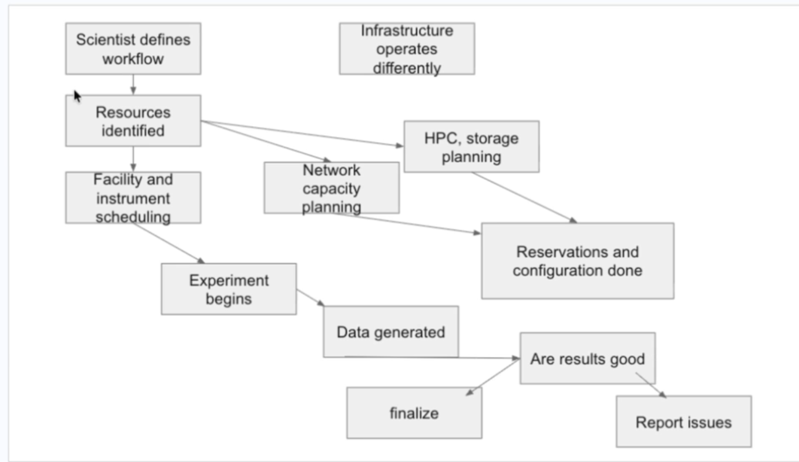

# 2026-10-13 SciNet 全体会议：agent 实现起步、UCR 分工、Mininet/VIT 与共享框架

> **日期**：2026-10-13（用户称为“今天的 SCINET meeting”）。录音详情显示 `Today, 10:01`、时长 `54:46`；备忘录创建时间显示 10:57。录音时间不一定等于正式开会时间。
>
> **原始材料**：本地 Apple Notes「UCR组会 → 10.13 SCINET」中的一段录音自动转写，以及 13 个图片附件。图片包括参会截图、仓库截图、slides、任务分解表和聊天链接。本文通过备忘录界面直接读取，并用 `Copy Transcript` 取得完整转写；附录 B 原样保留该文本，约 6,816 个英文单词。
>
> **可靠性**：自动转写没有可靠的 speaker labels，也没有逐段时间戳；存在大量人名、项目名和术语误识别。正文根据上下文整理并用截图校正，但没有逐段回听录音。Mariam、KK、Harvey、Rafael、John 等发言归属仍主要依据点名、问答关系及讨论内容；不确定处另标 `[待核对]`。截图确认姓名，不自动证明某句话的说话人。
>
> **整理范围**：按会议推进顺序保留技术讨论、分歧、人员介绍、行政安排、资源建议和会末重申；删除口语填充与重复寒暄。截图可见的 Task 1、Task 4.4、Task 5 内容另逐项整理。没有读取完整在线任务表或链接网页，没有用外部资料补全未展示的内容。
>
> **状态区分**：下文的“会上说法”“草案”“建议”“拟安排”均不等于已经实现、验证或正式批准的方案。附录 B 保留误识别原文，不能直接作为事实引用。


## 核心摘要

本次会议把讨论从架构和任务规划推进到开始写代码。Mariam 已在 `SelfDrivingNetworkLab/SciNetGenesis` 仓库放入两个示例 workflows，并按 proposal 的 milestones 分解任务。UCR 一侧指出，已有的 workflow → scheduling → network 架构不应被一个让 workflow agent 集中决策的新草图取代；团队随后认可同时推进 **top-down 的总体任务/框架** 与 **bottom-up 的 network/telemetry agent**，通过实际实现逐步整合。

近期分工是：**UCR 先围绕现有 workflow 示例开发 network agent，并接入至少一个初步 telemetry agent；随后接 scheduling agent，再与 workflow agent 协作。Mariam、Rafael、Aaron 及 HPE 一侧推进整体 agentic framework、agent 架构与 skills。Caltech 一侧补充 HEP workflow。** UCR 可以在共享仓库中建立自己的目录，不必等待整体框架完成。

针对 VIT 难以推进的问题，Mariam 同意 **UCR 可以先用 Mininet 开发**，并表示由她跟进 VIT 的障碍，与相关人员讨论。会议没有决定从 proposal 中取消 VIT，也没有确定 Mininet 原型如何回接 VIT。原定本周五的联合 coding/hackathon 拟移至下周 Mariam 可参加的时间；具体新时间未定。KK 表示会在接下来几天与学生讨论已有 agent 框架，争取下周展示可见进展。

技术路线方面，会上强调复用已有 monitoring、API、MCP/inference 接入和 agent 框架，先把 agent 要完成的 skills 定义清楚，再选择或接入 harness。硬件加速仍属 Task 5 的后续工作。Beam、Berkelium、NRP LLM 服务、OFCnetLLM 和 Analysis Grand Challenge 被提出作为候选资源或参考，均未在会上完成选型。

## 一、参会信息与新成员介绍


### 1. 截图可确认的姓名

参会画面可见以下显示名；这不是完整、持续更新的出席名单：


| 截图显示名                          | 本文称呼 / 说明                                 |
| ------------------------------ | ----------------------------------------- |
| Linxuan Zhong                  | Linxuan                                   |
| Kiran, Mariam                  | Mariam Kiran                              |
| Sourabha Bharadwaj Bangalore … | Sourabha；显示名后半部分被截断                       |
| Matson, Raymond                | Raymond Matson                            |
| Welch, Aaron                   | Aaron Welch                               |
| Ferreira Da Silva, Rafael      | Rafael Ferreira da Silva                  |
| Tourrilhes, Jean               | Jean Tourrilhes                           |
| Sharma, Puneet (Fellow&VP …)   | Puneet Sharma；职务后半部分被截断                   |
| Harvey Newman                  | Harvey                                    |
| Julia Rose Levy                | Julia                                     |
| Kadangode K Ramakrishnan       | KK                                        |
| Carlyn Lee                     | Carlyn；转写多次写成 Carolyn / Carlin / Carolina |
| 遮蔽号码的电话接入者                     | 身份不能由截图确认                                 |
| Harvey's Notetaker Otter.ai    | 记录机器人，不计作真人参会者                            |


开场有人提到 KK 可能稍后加入；新成员介绍后主持人确认 KK 已加入。会末 KK 又询问两位新成员是谁，主持人说明她们在他加入前已做介绍。

### 2. Harvey 介绍 Carlyn 与 Julia

Harvey 介绍 Carlyn 已与团队合作一段时间，过去在 JPL communications group 任职，目前在一家准备 satellite missions 的 space startup 工作，并参与 federated learning。公司名在转写中为 `oligos Space` / `Oigo space` 等，截图没有提供正式拼写，保留为 `[待核对]`。他认为 Carlyn 对实现 agentic architecture 很感兴趣。

Julia 的背景包括 astrophysics 与 journalism，也对 SciNet 的工作和贡献机会感兴趣。

### 3. Julia 的自我介绍

Julia 当时在办公室，摄像头配置尚未处理好，先用音频介绍自己：

- 本科 double major 为 astrophysics 与 computer science。
- 刚获得 Northwestern 的 journalism 硕士学位，希望重新进入 academia 的工作环境。
- 通过 Carlyn 所在的同一家 space 公司与 Harvey 建立联系。
- 特别感兴趣的是 SciNet 对 Rubin Telescope 的应用以及大数据问题。
- 她的一项 senior thesis 是为天文学大型数据集开发 AI / machine-learning 工具。
- 她表示会去 Chicago 的 Supercomputing 活动协助 Harvey 团队；地点是她在会中的说法，本文未查证活动安排。


### 4. Carlyn 的自我介绍

Carlyn 开始时遇到音频问题；她表示此前与 Mariam 见过，并已与 Harvey 合作数年：

- 参加过 SC24，去年在 SC25 做过一个 demo；自动转写对 SC24/SC25 和 demo 名称识别不清，年份按上下文整理，需回听确认。
- 希望今年改进该 demo，并更直接参与 SciNet 的准备工作。
- 当前正与 Julia 和一位转写为 `J` 的人员在 Caltech server 上测试某种 transceiver，并为 Caltech booth 做准备。具体 transceiver 名称和 `J` 的身份未能从材料确认。


## 二、开场问题：团队有没有可复用的 agentic framework

开场先询问团队是否已经开发过 agentic framework，以及能否分享示例 GitHub 代码。提问者将需求解释为：用 OpenAI API，或免费的本地模型/运行方式，开始搭建 agents、tools 和框架。

回应者表示团队做过相关项目，但部分代码属于 internal / proprietary，不能直接把这些材料视为可公开共享；可以寻找可分享的项目。相关人员姓名和这段回应的确切归属不清。

这条请求在后面多次重申：希望找到一个已有骨架，让团队能直接插入 agents，并复用 MCP servers 与 inference engines 的连接，而不是每个小组重新搭建底座。

## 三、Mariam 展示仓库现状与 workflow 示例


### 1. 仓库访问与提交状态

Mariam 表示已把部分成员设置为管理员，让人员加入和后续贡献不必都依赖她一个人处理。会上另一位与会者说，前一天查看时尚未看到更新；Mariam 随后共享屏幕，说明刚开始分批加入内容，并现场展示仓库。

截图确认共享仓库为 `SelfDrivingNetworkLab/SciNetGenesis`，当时标记为 **Private**。根目录可见：

```text
scinetagentframework/
vittesting/
workflows/
.gitignore
README.md
anothertest.py
test.py
```

这些名称只用于记录当时画面，不代表目录内部已具备可用实现。Mariam 明确说 `vittesting` 当时还没有内容；agent 框架正处于开始搭建的阶段。

### 2. 两个起步 workflow

Mariam 从 Rafael 提供的 workflows 中先选了两个例子：

- Chameleon 的 Hello World。
- 1000 Genome project。

她说明只是先选两个开始工作，其他示例也可以继续加入，并未把这两个确定为最终科学 demo。她希望 workflow agent 读取 workflow、添加网络参数，再推进下一步处理。

仓库 README 截图中的条目如下，数据仅是示例附带信息，不是本项目本次测得的实验结果：


| 文件 / ID                                  | Tasks | Files | Sum file sizes | Runtime   |
| ---------------------------------------- | ----- | ----- | -------------- | --------- |
| `helloworld-forkjoin-10-chameleon.json`  | 10    | 11    | 95.37 MB       | 17.15 min |
| `1000genome-chameleon-2ch-100k-001.json` | 52    | 64    | 2465.08 MB     | 46.19 min |


### 3. Mariam 正在学习和参考的框架

她已开始写 agents，但在理解现有开源示例和代码组织方面遇到困难。她倾向先参考 Ollama 示例，认为免费、本地运行能提供比付费 API 更大的灵活性，并询问团队是否有不同意见。**会议没有正式选定 Ollama、某个模型或某个 API。**

截图可确认两个参考仓库：

- `AIAnytime/AI-Agents-from-Scratch-using-Ollama`：可见 `agents/`、`utils/`、`app.py`、`requirements.txt`、`test.py` 等。
- `bhatti/agentic-ai-tutorial`：README 标题为 “Agentic AI Tutorial with Ollama”；可见 `requirements.txt`、`run.py`、`setup.py`、`test_ollama.py`。教程截图称包含四种基本模式，但本次截图只清楚展示了 ReAct 和 RAG，不能据此补写剩余两种。

Mariam 计划当天及随后两天继续推进代码。本周五因行程不能参加，但希望在此前与承担任务的人分别沟通，保证其他成员仍能开展工作。

## 四、传统 workflow 图与 agent 架构职责的分歧


### 1. Mohammed、John 在哪里参与

一位与会者询问是否已向 Mohammed 等网络侧人员征求对架构和 agent 框架起步的意见。Mariam 认为，当网络部分开始搭建时，他们会更直接参与。

她解释自己按此前建议向 Claude、ChatGPT 询问如何组织项目，再把建议整理成初步流程。她在传统 workflow 的 network planning、reservation 和 configuration 部分指出，Mohammed 和 John 的经验会有帮助。此处并未形成具体接口或网络团队任务分配。

### 2. 截图中的传统 workflow



`13Oct2026` slides 的第 2 页显示如下节点与关系：

1. Scientist defines workflow。
2. Resources identified。
3. Facility and instrument scheduling。
4. Network capacity planning，以及 HPC / storage planning。
5. Reservations and configuration done。
6. Experiment begins → Data generated。
7. 判断 Are results good；随后 finalize 或 Report issues。

图上另有 “Infrastructure operates differently” 节点。按 Mariam 的解释，当前不同基础设施及规划/执行流程相对独立，她希望 agents 能介入中间进行协调。这里是工作过程草图，没有展示一个已经跑通的系统。

### 3. Mariam 的初步 agent 草图

按口头说明，她把 science workflow agent 放在上层，下方 orchestration layer 包含 network、data、compute、reliability 等 agents。Scientist 与 workflow agent 交互，再由其参与资源判断和调用下层功能。

完整 agent 架构页没有在现有截图中清楚展开，因此这里记录的是口述，不能把它当作已核对的正式架构图。

### 4. UCR 对职责划分的质疑

UCR 一侧（按问答内容归属 KK）指出，这与此前的架构不完全相同：

- Workflow agent 理解实验 workflow 的 dependencies。
- Workflow agent 与 scheduling agent 对接。
- Scheduling agent 与 network agent 交互。
- Network agent 提供资源 offers / network capacity planning 信息。
- Scheduling 与 network agents 之间通过 negotiation 安排单个 workflow，并协调多个竞争 experiments。

KK 的疑问是：新图似乎让 workflow agent 承担了许多原本由 scheduling / network agents 完成的决策。Mariam 回应图可以调整，当前只是从最基本流程开始写，预计随着实现会接近此前讨论的路线。

### 5. 确定性起点与真实运行期能力

一位与会者认可把 deterministic、具体的流程先写清楚，但强调随后需要找到加入以下能力的位置：

- 实时行为与运行进度 monitoring。
- 资源 contention / competition 下的 negotiation。
- 来自外部的 priority、资源分配判断参数。

他认为这些可以从初步确定性流程逐步演化，而不是必须第一版就包含所有复杂性。

### 6. “是否在往回走”与现有 UCR 架构

另一位与会者追问：KK 学生已经有基本 framework，为何不从那里开始，而要重新从头设计？回应指出此前主要是设计，尚未实现。

KK 解释 UCR 原来的计划仍然是：实现具体 workflow 与给定网络资源下的架构，在实践中区分哪些问题可用 rule-based strategies，哪些情况需要向 LLM 请求额外信息。要做这件事，需要一个可工作的 underlying digital twin；已检查过的 VIT 感觉限制较多。

Mariam 回应，上一周她理解团队必须使用 VIT，因此围绕 proposal 规划了任务。会上同时确认，**UCR 的原架构并没有偏离 milestones**；分歧主要在起步顺序和职责划分，而不是一方做 proposal、一方偏离 proposal。

## 五、milestones 与 top-down / bottom-up 两条实现路径


### 1. Mariam 的任务分解

Mariam 表示已把需要在 December 交付的四个 milestones 分解成 tasks/subtasks，希望先推进其中若干部分，再检查依赖。她做任务表时打开了学生 slides，把已有的 workload requirements、network 与 workflow patterns、semantic graphs 等工作纳入。

她尚未为所有细项指定负责人，自己准备首先牵头 agentic framework。任务很多，最终必须组合起来，因此希望先开始写框架，再逐渐移动和组织组件。

会上有人确认这响应了上次 PM 要求“stick to your milestones”的反馈，且 UCR 架构也在这些 milestones 范围内。完整 Task 2/3/4 任务表未出现在现有图片中，本文不补造其细项。

### 2. KK 提议两条路径并行

KK 将两侧工作概括为：

- Mariam：top-down，把整体交付物拆成任务并构建总体框架。
- UCR：bottom-up，先形成 network agent，再接 scheduling agent，并确定 telemetry agent 的需求。

他提议同时保留两条路径：UCR 从 Mininet 这类 network emulator 可提供的 telemetry 出发，先搭建 network agent，再观察其如何进入总体框架，一步步填充整体任务图。KK 在会中称 Mininet 类 emulator 也是 VIT 所依赖的网络部分；这是会中的描述，本文未独立核验 VIT 的实现。

Mariam 同意总体框架足够灵活，UCR network agent 可以作为其中一个组件。

### 3. 独立目录与后续合并

Mariam 明确允许各组建立自己的 folders，不必受当前目录结构限制。UCR 可以先把 network agent 放在自己的目录里；整体框架一侧观察组件形成的样子，随后再移动、整理并合并。

她会跟踪各方开发进度，确保最终形成共识和一个系统。**这是一项允许并行起步的安排；会议没有定义 agent registration、message schema、MCP 协议或 integration contract。**

### 4. UCR 的组件推进顺序

KK 明确提出两个相互依赖的初始组件：

1. 至少一个 rudimentary telemetry agent。
2. 与之对接的 network agent。

两者联通后再推进 scheduling agent；scheduling agent 与 Mariam 一侧的 workflow agent 协作。

Mariam 的任务草稿已有 network intelligence、traffic engineering、compute（该处转写为 `ute`，按上下文整理）、coordinator 等 specialized-agent 例子，允许继续增加。KK 表示 UCR 希望把 scheduling 作为一个明确、单独的组件，而不是只隐含在 compute/storage 或 traffic engineering 中；这部分会随实现继续调整。

### 5. 进度追踪方式

任务表向团队开放编辑，可以补任务、写 notes、更新完成状态。Mariam 询问这是否满足上周对详细计划的要求，并提出也可建一个 ticket board，随着实现移动 tickets；转写为 `trailboard`，可能指 Trello board，名称待核对。**会上没有确认 board 已创建或决定采用哪个管理工具。**

## 六、优先复用既有工具与已有 agent 底座


### 1. Agent 是组合已有能力

一位与会者（按内容可能为 Harvey）强调，想到 agent 不应立即等同于从头解决所有问题。Monitoring 已有许多工具，包括 John 之前提到的能力；实现应组合这些现有功能，agents 主要通过 API 使用它们。

这样也能利用 DOE 组织（如 ESnet）已有工作，并借助 NRP。Mariam 认可 agents 的工具层主要会调用这些 APIs。

### 2. 对 UCR 已有 dummy-agent 框架的请求

有人询问 UCR 团队是否能把已有的基础 agentic framework 分享出来，哪怕第一版只是 dummy agents、agent 的空骨架或接口。

请求的重点包括：

- 有一个可插入 agents 的基础结构。
- 不让 Mariam 重复处理 MCP servers 的搭建。
- 复用 inference engines 与 agent 系统的连接。
- 即使 agent 本体暂时没有完整逻辑，也可以先共享组织方式和可运行底座。

讨论提到 Songyu（转写 `song you` / `song`）在此前实验或评估中已有相关框架。具体项目名、完成度以及能否直接共享没有在会上展示。

### 3. KK 的回应

KK 表示会与自己的三位学生坐下来讨论，查看 Songyu 已有的 dummy-agent/framework，补出 network agent 最基本的核心功能，并看能否复用其已有 LLM/inference 接入方式。

他计划在接下来几天处理，尊重学生选择的 coding 方式，并争取下周有可见进展展示；未承诺具体功能清单或完整系统交付。

## 七、Carlyn / Julia 的 onboarding 与仓库访问

Carlyn 表示浏览 SelfDrivingNetworkLab 时，还看不到 SciNetGenesis 仓库；她仍在通过一个 desk/onboarding 系统办理手续。系统名在转写中不清楚。

Mariam 回应 Heather 正在处理两人的 `pass` / 访问手续，完成后由她或其他管理员加入仓库。`pass` 所指的具体资格或审批类型未得到材料确认。

Carlyn 表示表格曾要求 student information，她不确定应如何填写，但已提交一些信息并建立账户，将再与 Heather 跟进。

会末 Mariam 再次说明，Julia 与 Carlyn 的手续通过后才可授予 GitHub 访问；**没有在会议中确认两人已经取得访问权**。

## 八、Rafael 的建议：先定义 skills，再决定 harness


### 1. 框架选型之前先明确功能

Rafael 建议先为希望 agents 完成的事情开发和定义 skills。明确 skill 后，再组装 agents、连接服务，或接入不同 harness 会更容易。

他提到存在多种 harness/框架选择，包括转写可能对应 Codex、Claude 和 Academy 的例子；具体列举名称有明显误识别，不能据此认定团队已选用其中任何一种。

这一建议针对的是功能与框架的解耦：先知道 agents 要做什么，而不是首先争论底座名字。会上没有定出 skill schema、skill database 格式或通用调用协议。

### 2. 简化 use case 要保留复杂化空间

另一位与会者补充，短期应展示一个简化、正常运行的 use case，同时保留逐步增加 realism / complexity 的 hooks：

- 资源竞争越多，决策越难。
- Success metrics 也会随现实问题变复杂。
- 评价最终要能够说明，在困难约束下结果为什么已经足够好。
- 问题是多维优化，不同标准可能性质不同、并不一致，既有硬边界也有需要权衡的目标。

这不是已经完成的优化算法或指标定义，而是要求在第一版架构中保留扩展空间。

## 九、workflow 用例与各方近期分工

Mariam 用此解释为何先放入两个示例：学生可以选择一个 workflow 开始，让 network agent 或 workflow agent 读取并决定下一步，从实际输入开始落实设计。

会议中的分工口径是：


| 团队 / 人员                      | 近期工作                                                                                 | 依赖与未决边界                                   |
| ---------------------------- | ------------------------------------------------------------------------------------ | ----------------------------------------- |
| UCR / KK 与学生                 | 用已有 workflow 示例推进 network agent，先接 rudimentary telemetry agent，之后考虑 scheduling agent | 可先独立实现；整体集成接口尚未定                          |
| Mariam、Rafael、Aaron 与 HPE 一侧 | 开始整体 agentic framework、agent architectures、skills / skill database 的工作               | agent 数量和职责可调整；不是要求重写已有工具                 |
| Caltech / Harvey 一侧          | 补充代表性的 HEP workflow                                                                  | 需要 end-to-end 步骤/图，Rafael 可帮助表达为 workflow |
| 全体                           | 审阅任务表，补充内容并认领任务                                                                      | 具体 owner 尚未全部分配                           |


Mariam 表示未来还会加入 HEP workflow 和 AI workflow；所开发的 agents 应能服务这些不同 workloads。现有 Hello World / 1000 Genome 是起步输入，不等于最终的 HEP + AI 双 demo。

## 十、原定周五 coding / hackathon 的调整

原来讨论的是本周五约 10:00–13:00 的开放 coding 时段。可以自由加入和离开，沟通各自进展，不是要求全程参加一个长会议。转写没有给出该时段时区。

KK 起初将 hackathon 理解为多人长时间一起开会，随后确认更接近独立 coding 加在线沟通。他表示学生可按自己的方法开发，不必为了形式改变工作方式。

Mariam 周五将从 India 飞往 US，无法参加。会上有人追问为何安排在她不在的时间；她询问 Rafael 能否改到下周，并表示下周她可参加。

因此本次会议的结果是：

- **拟把联合 coding 时段移至下周 Mariam 可参加的时间**。
- 本周与下周先由各组开始独立构建，再集中查看各方进展。
- **具体日期、时区和时间尚未确定**。若按本次日期换算，“本周五”是 2026-10-16，“下周”是 2026-10-19 当周；这些只是相对日期换算，不是新发出的会议邀请。


## 十一、继续寻找可复用框架：OFCnetLLM 与其他示例

Mariam 再次请求各方发送已有 agentic-framework 示例，表示目前只找到两个 GitHub 教程，正在理解代码组织、agents 与 tools 的连接。

她提到 Oak Ridge 有人做过 network agentic framework / LLM 项目，可以向该人员寻求起步建议。转写中的人名类似 `Hongun`；仓库截图显示最近提交者为 `hongjunv`，不能仅凭用户名确定真人全名。

截图确认该仓库为 `SelfDrivingNetworkLab/OFCnetLLM`，当时同样标记 **Private**，可以看到：

```text
sample_data/
.gitignore
LICENSE
README.md
draw_controller.py
generate_synthetic_snmp.py
llm_procs.py
main.py
ofc_data_loader.py
proc_anim.gif
requirements.txt
test_error_summary.py
```

画面中的最近提交摘要涉及把 Ollama model 设为 configurable、记录 synthetic data，较早摘要涉及现代化 LangChain usage 与 README 更新。截图不能证明其接口或 agent 功能可直接用于 SciNet。

Mariam 在口头讨论中对仓库公开状态有些不确定，并表示可以公开/分享，但**截图显示当时是 Private；本文没有修改访问权限，也没有确认会后已公开**。

与会者希望尽可能取得 pointers，避免学生重复造已有框架。还提到可参考用于 benchmark agentic-system 不同部分（例如 memory）的框架或所带 benchmarks。有人请 Raymond 帮忙联系相关人员获取参考；此请求的具体对象和责任分配仍需核对。

Mariam 重申：任务表围绕已承诺 deliverables 设计，防止额外工作偏离 proposal；她认为需要首先交付的核心是 agentic framework，再与 networking 专家对齐 agents 如何使用网络。

## 十二、Mininet 与 VIT：允许先开发，但迁移方案未定

KK 直接询问：图中 digital twin 一块，UCR 应继续等 VIT，还是可以用 Mininet？

Mariam 明确回答可以用 Mininet。她承认 VIT 存在推进障碍，愿意牵头查找瓶颈，和转写为 `Saurabh`、`Anis` 的人员一起讨论问题。后者姓名拼写以及前者究竟对应谁都不能仅凭本段确认；不自动把 `Saurabh` 与参会的 Sourabha 视为同一人。

她希望各组有足够自主权开始构建，同时由她参与牵头和协调共识。

这段安排的边界是：

- 明确允许 **Mininet 作为近期 network-agent 开发环境**。
- VIT 的问题由 Mariam 跟进，不要求 UCR 在开始写代码前解决所有平台问题。
- **没有取消 proposal 中的 VIT 交付要求**，也未证明 standalone Mininet 已满足全部 milestone。
- 没有给出 Mininet → VIT 的迁移计划、可用 telemetry 清单、部署拓扑或已解决的瓶颈。

与上一周 PM 口径的衔接可参见 [2026-10-06 会议记录](20261006_pm_sc_demo.md)；这只是历史背景，不能用旧会议替代本次未定的技术细节。

## 十三、硬件加速：承认后续价值，先完成基本 agent

Harvey 提出当前仍未完全解决实现分工和软硬件路线的问题。他正在考虑 NVIDIA GPUs 与 BlueField-4 的交互，可能借助硬件高速执行 transaction、caching、policy 等工作，以及 edge-computing / decision-making 能力。

> 转写将设备写成 `Bluield Fort GPUs`。本文按上下文记录为 BlueField-4；设备类型和具体 BOM 尚未由本次材料验证，不能将原转写的 “GPUs” 当作准确分类。

另一方回应：当前先在 digital twin 上让 agents 跑起来，这一实现阶段不必先解决严格的硬件加速问题。Mariam 明确把这归入 **Task 5**，要求先弄清 agents 的 skills 和基本实现，之后再优化和加速。

Harvey 承认应优先完成 milestones，但提醒后续可能被问到为什么未采用更快的已有实现。他举“其他代码快一百倍”说明可能的质疑，**不是本次测量结果**。

Harvey 还报告：有希望在月底附近拿到相关系统，但仍需确认实际交付符合 BOM；对方正在争取在本月给出更明确日期。**没有确认设备已经到货，也没有确定系统型号和最终到货时间。**

有人再次建议把 John 介绍的现有工具用起来。Mariam 回应，skills 与 API 实现可以成为 network agents 使用 networking tools 的入口；她本周和下周持续在线写代码，各方可直接联系她，也应彼此沟通。

## 十四、John 分享 Beam、Berkelium 与 NRP LLM 资源


### 1. Beam 是候选模型，不是已选方案

John 在聊天中分享 Reflection 的 Beam 模型与 About 页面。截图中的标题是 **“Introducing Beam: Reflection’s 501B open-weight model”**，聊天时间为 10:29。

按 John 在会上介绍：

- Reflection 预计在当月稍晚发布 Beam 的 open weights。
- About 页面提到与 NVIDIA 的合作，以及支持 U.S. National Labs / Genesis Mission；他认为这可能是适合在 SciNet 展示的美国来源模型。
- 自部署需要大型机器，现有团队硬件未必能承担；他用 Kimi/Qwen 级别的大模型作对比，但转写中的具体版本（`Kimmy K3`、`Quin three dot`）不可靠。

以上是当时会议口头信息与截图标题，**没有独立核验发布时间、部署需求、合作条款或可用性**。

### 2. Beta API 与实际 early-access 状态

Carlyn 追问 developer documentation、REST endpoints 等是否已可使用。John 认为可以注册 beta API，模型已可通过服务运行；open weights 还需要等待，不能立即在自己的硬件部署。

随后 Carlyn（按上下文归属）现场尝试注册，实际只收到 early-access 确认，将在有名额时收到通知。对方确认她当时能做的就是等待。

因此需要分别记录：**会上介绍了 beta API；至少这位注册者并未当场获得可用访问，而是进入等待 early-access 名额的状态。**

### 3. 关于模型来源与 DOE infrastructure 的讨论

一位与会者认为，这类美国 open-weight 模型也有与中国模型竞争的战略意义；这是个人判断，没有形成项目技术决定。

Mariam 指出团队最终要构建能控制 DOE infrastructure 的 agentic framework，因此必须清楚所用模型和工具在做什么，否则可能无法获得连接基础设施的许可。会议没有给出已获批准的模型清单或部署政策。

另有人指出当前产业合作环境与过去不同，可能反而需要说明为什么不采用 industry 已有成果。Mariam 表示在采用此类 industry-developed 工具前，会再向 PM 确认其态度。

### 4. Berkelium / LBNL 的潜在部署资源

John 提到一位曾负责 NRP 开发、现已在 Lawrence Berkeley National Laboratory 工作的人员，正在建设类似 NRP 的大型 Kubernetes cluster，并有 B300 nodes。他表示前一天已分享 Beam 信息，对方计划在 open weights 发布后部署，团队也许能够较容易取得 agent 开发所需访问。

该人员姓名在转写中先写成 `demaission`，后又写成 `Das`，本次未获得姓名截图，不补写全名。

截图确认 John 在 10:49 分享：`http://berkelium.scs.lbl.gov/`，预览标题为 “Berkelium | LBNL Science IT …”。**这只是潜在资源路径，不代表已申请、获批或已运行 Beam。**

### 5. NRP 的现有 LLM 服务

John 在 10:52 分享 “Available Models | NRP Documentation”；预览描述为 NRP-managed LLM model catalog and feature matrix。

会末 John 表示，如果有人需要访问 NRP LLMs，可以给他发邮件，他会指引访问方式。他认为其中有几种模型适合 agentic workflows；末段对具体服务形态的转写不清，没有列出模型名称、账号或 endpoint。

## 十五、会末再次确认 UCR 与整体框架如何合并

Mariam 要求大家审阅任务表，看拆分是否符合预期，并可以自行填名字认领；她会发邮件分享链接。她再次重申：学生可从仓库的 workflow 示例开始，在自己的目录构建 network agent；她与 Rafael、Aaron、HPE 一侧继续整体框架。

KK 仍追问：已经展示过 network / scheduling architecture，另一个团队又在做 agent framework，两者究竟如何对应？

Mariam 回应：整体一侧先考虑 agents 应是什么样、建立各 agent 的 skill database，可能先放入约五个 agents；**五个是示例性说法，不是定稿数量**。UCR 自主设计 network agent，随后把该模块并入整体 agent team。

KK 因此确认 UCR 的起步边界：

- 暂时不等待整体框架细节。
- 假设 telemetry agent 提供所需信息。
- Network agent 结合 rules 与 LLM 调用，沿用之前的 overview architecture。
- 先在自己的目录实现，随后共同合并并整理。

Mariam 表示同意。这个会末重申保留了 UCR 的实现自主权，但 **没有消除后续接口对齐的工作，也没有确定 scheduling agent 的最终 owner**。

## 十六、Harvey 的 HEP workflow 参考：Analysis Grand Challenge


### 1. Mariam 希望收到 end-to-end 图

Mariam 请 Harvey 提供 HEP workflow 示例。Harvey指出实际 workflows 是多步骤、包含人的工作过程，并询问这里需要什么参数。

Mariam 说明可以先画图，表示某个 actor/步骤之后发生什么、数据流向哪里，给出一个代表性的端到端过程，再请 Rafael 把它表达为可用 workflow。Harvey 表示自己正在做，但同时有许多其他工作。

### 2. Analysis Grand Challenge 的作用

Harvey 在 10:54 分享 IRIS-HEP 的 Analysis Grand Challenge（AGC）。他把它介绍为一个已有整体规划、描述 end analysis 各阶段的参考，认为能帮助团队将真实分析流程映射到 workflow abstraction。

他称相关 institute 由 Princeton 牵头，并提到一位 Brazil 同事正在处理其中的具体问题；这些是会中的说法，未核验人员或组织关系。

AGC 页面截图可见的补充信息包括：

- 关注 HL-LHC 数据量增长对分析流程和系统的要求。
- 除 raw throughput 外，还要求 flexibility、ease of use 和较低 latency，以支持分析设计阶段。
- 将 analysis software components 的集成与在 analysis facilities 的部署结合起来。
- 以 prototype analysis use case 的 vertical slice 展示较完整的软件链，涉及 event selection、histogramming、systematic uncertainties 等。
- 截图底部部分图示包含 `cabinetry`，以及 event selection/systematics、histograms、statistical model、workspace、statistical inference、result diagnostics 等阶段；最下沿被截图截断，不能据此补写完整拓扑。
- 页面指向 `https://agc.readthedocs.io/en/latest/` 作为后续文档入口；本次未打开。

这些来自页面截图的描述，不是本项目已完成的 workflow 实现。

### 3. Compact event format 与 ServiceX

Harvey 解释一个具体问题：使用 compact event format 时，文件未必包含分析所需全部信息；`ServiceX` 应负责获取额外的数据 collections，但他认为其当前能力仍不足。现有 architecture 和分阶段结构可用于理解 workflow abstraction。

“能力不足”是会上评价，未给出具体缺失 API 或 benchmark。Compact event format 的正式名称亦未确认，本文不补写某个特定数据格式。

### 4. AGC 仍不具备所需 network awareness

Harvey 强调，即使该工作流看起来完整，它也不是 network-aware，在很大程度上也不 infrastructure-aware：表达了需要什么，但没有完成相应资源/网络决策。

Mariam 认为这与团队看到的其他 workflows 类似，正可作为后续补充网络信息的输入；她会与 Rafael 讨论如何使用它。

## 十七、截图中任务分解表的细节

> 来源：`SciNetTask breakdown` 的两张局部截图，分别为 `Pasted Graphic 16.png` 和 `Pasted Graphic 19.png`。以下是可见草表内容，不是独立核实的 proposal 正文。Task 2/3 和 Task 4 前半部分未展示，不能重建。日期、10% 和 notes 是当时表内标注，不等于实测进度或正式更改后的 milestone 日期。


### 1. Task 1 / M1：workflow + network foundation model

表头包含 `TASKS`、`Start`、`End`、`Completed (%)`、`Team`、`Comments`。Task 1 总行写：

- **标题**：Task 1 with M1 — Network foundation model for workflow + network。
- **Start**：1 Sept 2026。
- **End**：30th Oct（按上下文为 2026 年，表内该格未再写年份）。
- **Completed**：10%。
- **Comments**：Workflows。
- **Goal**：建立理解 scientific workflows、data-transfer requirements 与 network conditions 之间关系的模型。


| 编号            | 截图中的子任务                                                                                                          |
| ------------- | ---------------------------------------------------------------------------------------------------------------- |
| 1.1           | Define the model scope and requirements                                                                          |
| 1.1.1         | 选择代表性的 workflow patterns，包含 HEP data movement 与 AI training / inference workflows；该行附 workflow 参考链接              |
| 1.1.2         | 明确 network requirements：bandwidth、latency、loss、availability、transfer volume、deadlines、traffic priority           |
| 1.1.3         | 明确 workflow requirements：data dependencies、dataset sizes、execution stages、deadlines、compute/storage dependencies |
| 1.1.4         | 定义 model inputs、outputs 与 evaluation benchmarks                                                                  |
| 未编号补充行        | 发布 Science SLA 的 workflow + network semantic / knowledge graphs                                                  |
| 1.2           | Curate and correlate workflow/network data                                                                       |
| 1.2.1         | 收集代表性 network telemetry、flow records、transfer logs 和 network configuration data                                  |
| 1.2.2         | 收集 workflow traces、scheduler events、job metadata 和 data-transfer requirements                                    |
| 1.2.3         | 对齐 timestamps，将 network events 与 workflow stages 关联                                                              |
| 1.2.4         | 开发 common schemas 和 workflow-to-network knowledge representation                                                 |
| 1.2.5         | 处理 sensitive information、access controls 与 data governance                                                       |
| 1.3           | Develop the network foundation model                                                                             |
| 1.3.1         | 选择建模方法，如适配 network telemetry 的 pretrained model、multimodal model 或 specialized network model                     |
| 1.3.2         | 开发 workflows、network state 与 transfer requirements 的 representations                                             |
| 1.3.3         | 使用可用 traces 与 operational data 训练、fine-tune 或适配模型                                                                |
| 1.3.4         | 支持询问 workflow 需要多少 network capacity、哪些 network conditions 可能延误 transfer                                          |
| 1.3.5         | 为 downstream agents 提供 confidence estimates、supporting evidence 和 structured outputs                             |
| 1.4           | Evaluate model capability                                                                                        |
| 1.4.1         | 测试 workflow requirement extraction 与 network demand prediction                                                   |
| 1.4.2         | 对照 historical / simulated ground truth 评价 prediction accuracy                                                    |
| 1.4.3（下沿部分截断） | 可辨识为与 rule-based 及 conventional forecasting baselines 比较；完整行需任务表原文件核对                                            |


该表说明了 Mariam 如何把学生此前的 workflow/network requirements 与 semantic graphs 工作纳入总任务。**表中列出 train/fine-tune 候选步骤，不代表会上已经决定训练某个基础模型。**

### 2. Task 4.4：科学效果与可推广性

第二张截图顶部可见 Task 4.4 — Assess scientific impact and generalizability：


| 编号    | 可见任务                                                       |
| ----- | ---------------------------------------------------------- |
| 4.4.1 | 量化 network decisions 对 workflow completion 的影响             |
| 4.4.2 | 区分收益来自 prediction、coordination 还是 control                  |
| 4.4.3 | 评价跨 workflows 的 fairness 与 resource contention             |
| 4.4.4 | 记录 limitations，以及 operational deployment 所需额外 integrations |


紧接着的 deliverable 行写：**在 digital twin 上给出两个可复现 science-workflow demonstrations，展示 agentic network management 对 HEP 与 AI workloads 的作用。**

### 3. M5 / Task 5：加速网络硬件，包括 P4

总行标题为 **“M5 — Demonstrate with accelerated network hardware, including P4 devices”**，日期显示 **1 Sept 2026 → 1 Dec 2026**。

草表另有三条未编号 notes：

- Add other agents for hardware accelerator。
- Show before baseline。
- Show after managing。

Goal 是验证 agentic framework 能将 high-level scientific workflow requirements 转成 programmable hardware 上的实际 network-control actions。


| 编号    | 可见任务                                                                                          |
| ----- | --------------------------------------------------------------------------------------------- |
| 5.1   | Define the hardware testbed                                                                   |
| 5.1.1 | 选择可用 programmable switches、P4-capable devices、SmartNICs 或其他相关 accelerated networking hardware |
| 5.1.2 | 定义 hardware topology、link speeds、traffic generators 与 control interfaces                      |
| 5.1.3 | 区分哪些 data-plane operations 可用 P4 实现、哪些 control functions 保留在 controller / agents              |
| 5.1.4 | 建立 conventional hardware baseline，并核验 traffic measurement                                     |
| 5.2   | Integrate the agentic framework with the hardware                                             |
| 5.2.1 | 定义 agent coordinator 与 network controller 的接口                                                 |
| 5.2.2 | 将 agent decisions 转为支持的 device configurations / control-plane commands                        |
| 5.2.3 | 实现 hardware telemetry collection 与 feedback                                                   |
| 5.2.4 | 增加 policy checks、authorization、safe configuration updates 与 invalid-action recovery           |
| 5.2.5 | 验证 agentic framework 能观察实际 data plane 上自身动作的效果                                                |
| 5.3   | Demonstrate accelerated network operations                                                    |
| 5.3.1 | 生成代表性的 HEP 与 AI data-transfer traffic                                                         |
| 5.3.2 | 在 programmable hardware 上展示选定 network-control actions                                         |
| 5.3.3 | 根据 use case 测量 packet processing、throughput、latency、loss 与 control-loop response time         |


**需要保留的日期/范围歧义**：口头强调先完成四个 milestones、硬件放在 Task 5 后续处理，但草表显示 M5 到 12 月 1 日。会议未解释这个日期与 proposal 正式阶段安排的关系，不能自行将其改成 Phase 2，也不能据此宣称本次新增了 12 月硬件交付承诺。

## 十八、行动项与承诺状态

> 下表汇总会议中的安排，不构成本文作者新增的研究计划；“负责人”依问答上下文整理，具体任务 owner 仍以团队认领为准。


| 事项                                                           | 责任人 / 来源                         | 时间与状态                         |
| ------------------------------------------------------------ | -------------------------------- | ----------------------------- |
| 从两个已有 workflow 示例开始构建 network agent，配一个初步 telemetry agent    | UCR / KK 与学生                     | 可以开始；尚未现场展示实现                 |
| 随后接 scheduling agent，并对接 workflow agent                      | UCR 架构讨论                         | 推进顺序明确，最终 owner 和接口未定         |
| 查看 Songyu 已有 dummy-agent / inference 接入框架，讨论复用和 network 核心功能 | KK 与三位学生                         | KK 表示接下来几天讨论，争取下周展示可见进展       |
| 分享可复用 agentic framework / MCP / inference 接入示例               | UCR 与全体；会上请求                     | 尚未确认示例已发出                     |
| 开发总体框架、agent architectures 与 skills                          | Mariam、Rafael、Aaron、HPE 一侧       | 本周及下周继续推进                     |
| 各组可在共享仓库设独立目录，形成模块后共同合并                                      | 全体，Mariam 协调                     | 会上允许；integration contract 尚未定 |
| 审阅 task breakdown，补充 notes/subtasks，自行认领                     | 全体                               | 会后动作，owner 尚未全部落实             |
| 发邮件分享任务表链接                                                   | Mariam                           | 表示会发送；本材料未确认发送完成              |
| 把原定周五 coding 活动改到下周 Mariam 能参加的时间                            | Mariam / Rafael 协调               | 拟调整，具体时间未定                    |
| 允许 UCR 先用 Mininet；跟进 VIT bottleneck                          | Mariam；相关人员姓名待核对                 | 明确允许 Mininet，VIT 问题未解决        |
| 向 Oak Ridge 相关开发者寻求 OFCnetLLM / agent 框架参考                   | Mariam；会上也请 Raymond 帮忙找 pointers | 未确认已经取得或完成共享                  |
| 办理 Carlyn / Julia 的 onboarding / pass，再加入私有仓库                | Heather、Mariam / 管理员；Carlyn 跟进   | 尚未确认访问已获批                     |
| 提供代表性 HEP end-to-end 图或 workflow 示例                          | Harvey / Caltech 一侧              | 正在准备，未给出完成日期                  |
| 讨论用 AGC 构造可用 HEP workflow                                    | Mariam 与 Rafael                  | 表示会讨论，未确定具体输入                 |
| 向 PM 确认使用 industry-developed 模型/工具的态度                        | Mariam                           | 表示会确认，尚无回复                    |
| 探索 Beam 发布后的 Berkelium 部署和可能访问                               | John 提出的资源路径                     | 潜在选项，不是已获准资源                  |
| 提供 NRP LLMs 访问指引                                             | John；有需要者邮件联系                    | 可联系，本文未代发邮件                   |
| 将本次分享的 links 汇总成 page 并发给大家                                  | Mariam（按会末上下文归属）                 | 表示会做，未确认完成                    |
| 核实硬件 BOM 与交付日期                                               | Harvey 与硬件提供方                    | 可能月底获得系统，仍待确认                 |


## 十九、未决问题与转写校正记录


### 1. 技术与协作边界仍需对齐

- Workflow agent、scheduling agent、network agent 的最终职责划分，及整体侧与 UCR 的 integration contract。
- Rudimentary telemetry agent 的最小输入/输出、实际数据源和可用指标。
- UCR 原型如何从 Mininet 进入 VIT，VIT 的具体障碍及负责解决的人。
- 要复用哪个 agent harness / MCP / inference 底座，Songyu 与 OFCnetLLM 框架能提供什么。
- Skills 的格式、database 组织、agent 注册与调用方式。
- 示例 workflow 需要补哪些 network parameters，最终 HEP 与 AI demo 分别选什么。
- Task 1 的 network foundation model 是何种实现，是否真的需要 training/fine-tuning。
- 多 workflow 竞争时的 success metrics、priority 与多维目标处理方式。
- Coding 活动的最终时间、任务 owner，以及合并节奏。
- Beam / NRP / Berkelium 的模型选择、访问权限、基础设施许可和 PM 反馈。
- Task 5 草表日期与正式 proposal 阶段安排的关系，以及硬件系统的确切 BOM。


### 2. 人名与术语的处理


| 原转写或歧义                            | 本文处理                               | 依据 / 限制                       |
| --------------------------------- | ---------------------------------- | ----------------------------- |
| Miriam / Maryam / Mariaam         | Mariam Kiran                       | 参会截图 `Kiran, Mariam` 与既有会议姓名  |
| Raphael / Rafel / Raphaael        | Rafael Ferreira da Silva           | 参会截图                          |
| Carolyn / Carlin / Carolina       | Carlyn Lee                         | 参会截图                          |
| Julia Levy                        | Julia Rose Levy                    | 参会截图                          |
| signet / signat / finite          | 相关语境下整理为 SciNet                    | 泛指项目时可校正；具体 demo 名仍待核对        |
| Camleon                           | Chameleon                          | workflow 文件名截图                |
| llama / Olama                     | 按语境分开处理模型与 Ollama runtime          | 不把所有 `llama` 都机械替换，也不据此确认模型选型 |
| minette / mini net / PIT          | 问答明确语境整理为 Mininet / VIT            | 仅对清楚对应的段落校正                   |
| UE / DE infrastructure            | 相关语境整理为 DOE infrastructure         | 依据项目与问答；不补写具体设施               |
| HBC / computer agent              | HPC / compute agent                | 传统流程截图与上下文                    |
| telementary / teletary            | telemetry                          | 技术讨论上下文                       |
| song you / song                   | Songyu                             | 与 KK 学生框架的上下文；正式项目名未知         |
| Goldux cold / hardness / theademy | 可能为 Codex / Claude、harness、Academy | harness 可按语义校正，列举的产品名仍待回听     |
| trailboard                        | 可能为 Trello board                   | 仅保留为候选解释，没有确认建 board          |
| UFC net                           | OFCnetLLM                          | 仓库截图                          |
| Hongun                            | 不补写真人全名                            | 截图仅能确认提交用户名 `hongjunv`        |
| oligos / Oigo Space               | 公司名待核对                             | 没有清楚公司名截图                     |
| J / transiver                     | 人员与 transceiver 名待核对               | 不足以确定具体人或设备                   |
| Saurabh / Anis                    | 名字待核对                              | 不自动与 Sourabha 合并              |
| Bluield Fort GPUs                 | 可能为 BlueField-4                    | 上下文推断；设备类别/BOM 未核验            |
| demaission / Das                  | LBNL cluster 开发者姓名待核对              | 本次无可靠姓名证据                     |
| Cooper nice / Berkeleyum          | Kubernetes / Berkelium             | 聊天链接与技术语境                     |
| Kimmy K3 / Quin three dot         | 只保留 Kimi/Qwen 类大模型比较               | 具体版本待核对                       |
| service X                         | ServiceX                           | HEP 数据获取组件语境，未核验接口能力          |
| compact event form                | compact event format，正式格式名待核对      | 不补写具体格式                       |
| SC24 / SC25、Chicago               | 保留会上说法并标出可靠性限制                     | 未用外部日程校正口述                    |


## 二十、会中截图与参考链接索引

> 链接用于保存会上展示/分享的入口，没有对网页当前状态、代码质量或可用权限进行外部验证。部分地址来自截图中可见 owner/repo，已按 GitHub URL 结构整理；截图不完整的地址只保留已知名称/片段。


| 来源                    | 名称 / 入口                                                                                                           | 与会议的关系                                    |
| --------------------- | ----------------------------------------------------------------------------------------------------------------- | ----------------------------------------- |
| 仓库截图                  | [SelfDrivingNetworkLab/SciNetGenesis](https://github.com/SelfDrivingNetworkLab/SciNetGenesis)                     | 共享开发仓库；截图显示 Private                       |
| 仓库截图                  | [AIAnytime/AI-Agents-from-Scratch-using-Ollama](https://github.com/AIAnytime/AI-Agents-from-Scratch-using-Ollama) | Mariam 参考的 agent 示例                       |
| 截图可见完整地址              | [bhatti/agentic-ai-tutorial](https://github.com/bhatti/agentic-ai-tutorial)                                       | Ollama / agent 模式教程                       |
| 截图可见完整地址              | [SelfDrivingNetworkLab/OFCnetLLM](https://github.com/SelfDrivingNetworkLab/OFCnetLLM/tree/main)                   | 可能复用的网络 LLM 实现；截图显示 Private               |
| Task 1 表中可见地址         | [Pegasus example workflows](https://pegasushub.io/pages/workflows.html)                                           | 代表性 workflow 输入来源                         |
| Task 1 表中截断地址         | `wfinstances.ics.hawaii…`                                                                                         | 另一个 workflow 数据入口，完整 URL 不可确认             |
| John，10:29；后续网页截图可见地址 | [Introducing Beam](https://reflection.ai/blog/introducing-beam)                                                   | 候选模型介绍                                    |
| John，10:29，聊天截图       | [Reflection About](https://reflection.ai/about)                                                                   | John 用于说明国家实验室 / Genesis 合作背景             |
| John，10:49，聊天截图       | [Berkelium](http://berkelium.scs.lbl.gov/)                                                                        | LBNL 的潜在 Kubernetes / LLM 资源路径            |
| John，10:52，聊天截图       | Available Models，NRP Documentation（`nrp.ai`）                                                                      | 模型目录 / feature matrix；截图未显示完整页面 URL，不推造路径 |
| Harvey，10:54；页面截图可见地址 | [IRIS-HEP Analysis Grand Challenge](https://iris-hep.org/analysis-grand-challenge.html)                           | HEP end-to-end workflow 参考                |
| AGC 页面截图可见地址          | [AGC documentation](https://agc.readthedocs.io/en/latest/)                                                        | 后续详细文档入口                                  |


## 附录 A：备忘录图片附件覆盖清单

13 个图片附件仍保留在原备忘录，没有复制大件到仓库。以下顺序沿用备忘录附件顺序，便于回查。正文已记录其与会议相关的可读信息；浏览器工具栏、无关书签与纯装饰内容不作为会议内容转录。


| 顺序  | 备忘录附件显示名                                                            | 内容与正文对应                                                                      |
| --- | ------------------------------------------------------------------- | ---------------------------------------------------------------------------- |
| 1   | `Pasted Graphic 11.png`                                             | 参会画面；姓名与新成员介绍（第一节）                                                           |
| 2   | `Pasted Graphic 12.png`                                             | AIAnytime 的 Ollama agent 示例仓库（第三节）                                           |
| 3   | `This tutorial teaches you four fundamental patterns in agentic Al` | `bhatti/agentic-ai-tutorial` README 与可见 ReAct/RAG 说明（第三节）                    |
| 4   | `Pasted Graphic 14.png`                                             | SciNetGenesis 目录与两例 workflow README 信息（第三节）                                  |
| 5   | `Pasted Graphic 15.png`                                             | `13Oct2026` slides 的传统 workflow 图（第四节）                                       |
| 6   | `Pasted Graphic 16.png`                                             | Task 1/M1 分解表，起止日期与 10% 标注（第十七节）                                             |
| 7   | `Pasted Graphic 17.png`                                             | OFCnetLLM 仓库及文件结构（第十一节）                                                      |
| 8   | `Introducing Beam: Reflection's 501B open-weight`                   | John 分享 Beam 与 Reflection About 的聊天截图（第十四节）                                  |
| 9   | `Pasted Graphic 19.png`                                             | Task 4.4、两个 demo deliverable、M5/Task 5 表（第十七节）                               |
| 10  | `Pasted Graphic 20.png`                                             | Beam 博文中的 expert load balance 图；图示末端约 1.04x，为网页宣传/技术图，不是 SciNet 测量（第十四节资源背景） |
| 11  | `http://berkelium.scs.lbl.gov/`                                     | Berkelium 聊天链接（第十四节）                                                         |
| 12  | `Available Models                                                   | NRP Doc...`                                                                  |
| 13  | `Analysis Grand Challenge`                                          | AGC 相关聊天/网页截图及部分流程图（第十六节）                                                    |


## 附录 B：Apple Notes 自动转写原文

以下通过原备忘录的 **Copy Transcript** 取得，保留原有分段、口语、拼写和误识别，不进行纠错。开头是会前/开场对话，末尾包含散会寒暄。正文整理与此原文有差异时，先回到原始录音核对，不把误识别原文自动视为更准确的事实。

展开完整英文自动转写（未经纠错）

```text
That's a good um so I don't know I don't no I think no uh KK or professor kk is that I think is a bit to join.

So, uh, has anybody developed an agentic framework from the team So kind of like go ahead why don't you go first?

No, just in what do you mean by a chance gift framework at this point?

Okay, so kind of like uh building something from scratch, uh using, so building it on either open AI, APIs or llama is free. We have done somehow projects, but I think I think it had some has a lot of experience to all that no. . So, uh is it possible to share like the example gitubs so that we can start using that to build our own agentic framework what is a lot of uh internal propriet, but let me a wall in some project that Sounds good.

Okay, think all of us are here. Um so Harvey, do you want to introduce Carolyn and Julia?

Yes so uh Carolyn and Julia so Carlin, uh has been working with us uh for some time.

She was previously uh at JPL as a staff member in the communications group.

Now she's working with the oligos Space company, which is a startup company that is preparing a satellite missions and she's been working on federated umeterated learning um and so I think is very interested in implementing an eentic day at architecture and Julia Levy is has a background in um in astrophysics and also in journalism and has been very interested in um sign it and contributing also.

So maybe uh Carlin and Julia would like to introduce yourselves Hello, can you hear me?

Yeah, uh yes thank you for the kind introduction Harvey so my camera.

I'm currently in the office uh trying to figure out my care configuration uh but I'll just talk uh Olivia the audio so as far we mentioned my backgrounds and astrophysics I would uh double major astrophys computer science and I just received them masters of journalism from Northwestern um I essentially just uh graduated from that masters of journalism program, some I'm excited to get back from the academia space.

I connected with Harvey through the same company um Tarlan works out Oigo space and really interested on the particular sign at applications of the V Rubin Telescope and also just big data in general, um one of my senior theses was developing. Um some AI machine learning tools for for looking at large data sets in the astronomy space and was really excited for the opportunity to join this group.

In addition, I'll be at the supercomcuting Catherine in Chicago helping Harvey's team out as well.

Okay..

Um, yeah, and we have Julia, uh, okay, Carolyn as well.

Do you want to say something Carolyn?

Hi, how do you hear me?

Yes.

Oh okay, great. Um I was having some trouble with the audio.

It's good to to see you again.

Um.

I'm Carlin and um I think I met um uh I met with you before Miriam. Um, I and um, I've been working with Harvey um, for a few years now. Um, I participated in a um a C 24 and last year got to run a demo um on finite uh at a Centy five um so we're hoping to um make some improvements on that um this year and um, yeah, I'd like to, you know, get involved with um, uh, more hands-on, um preparation for signat and so right now I've been working with J and Julia, um, on the testing some of it transiver on thealtech um server and um helping prepare that for for the Caltech goose.

Hey, thanks to have you guys on the team. Um Okay, so KK is joined as well.

Hi KK.

So hi so, um so this week I've been doing an in-dep like really getting into the nitty gritty and starting to write the code um for uh our our work.

So I've converted some of you guys into admin's so that every so you don't have to depend on me to be added to the repository as people start adding things . So I have a few things to show, but looking yesterday for what updates have been made, but uh we couldn't find anything as of yesterday.

I think, but maybe you know you' insert put began things now.

Yeah, I started putting things I can show stuff uh let me share so I I just updated the repository.

So I'm doing it bit by bit.

I've started adding exam.

So I got some example where flows from Raphael. Um and I selected two so one is a hello world on Camleon and one is a thousand genome project. Uh so I just took two on random.

We can take any so I just started putting things together um so that we could start uh developing a workflow agent that takes one of these workflows, adds the network parameters and takes it to the next step. Um so so these are example workflows which I added to file if you have any other suggestions, we could add those here. Uh in the agentic framework, I've start to build up the agents.

I got stuck because I was looking at example repositories that exist on the web, uh, so for example, I found this one building AI agents from scratch . I was going to ask if people think strongly uh that I know llama is free and it gives us more flexibility than open AI and other APIs um so I was going to go with Olama examples and then basically start building agents, uh the tools and everything.

So I found two examples uh agent KKI tutorial and I' done this before, so I'm taking my time to understand how to do this.

So start building an agents here. Um and then for now I don't have anything under VIT testing. Um so this is the current status of the repository I'll continue working on this today tomorrow, day after tomorrow, uh Friday I will not be available, but I'll try to work with some of the people assigned tasks so then even if I'm not here, uh, you guys can work.

I think Rafel is going to be here.

I thought we up several hours, 10 o'clock to 1 o'clock be on Friday so it's it's open like it's not like it's just a hackathon thing so come and go like as you wish but everybody will be trying to build this up.

That's what we were thinking.

So uh a question hardly that input from Mohammed I mean a stage about, you know, getting started with the architecture and building Asian framework.

I think we can I think they will be more interested when we start building up the network part.

So, for example, I was trying to work out where this comes in and I was doing a lot of uh I was taking your uh suggestion.

I asked Claude and chargingPT like how do how do organize this project So the way um so this is the summary, which I have so far.

So this is a traditional workflow that runs right now in the UE.

A scientist defines the workflow resources are identified . Based on that you schedule things and then you do network capacity planning, HBC, storage planning.

So once this is scheduled the experiment begins, all of this runs independently, reservations and configurations are done, so this is where Mohammed and John would be very useful, but the experiment runs here, data is generated are the good results good?

Yes, we findized for papers or we report issues.

This is the basic thing.

So then I was asking uh the AI agents like where AI could help manage this.

So it gave me this that you would have a science workflow asian.op and this is the kind of agents we should have the orchestration layers, so network agent, data agent, computer agent reliability agent , which then can do all the things below so that means the same workflow which I showed in Slide two we can start mapping it to agents in the middle, so the signs test out talks to work flu agent, the workflow agent, then decides the resources.

So we can start implementing this like this where the agents will sit in the middle. Um and then when we reach these stages, um we can these are different than what we had been en investaging, right?

Which is that we had a workflow agent that understands the dependency of the experimental uh framework and then we talk to a scheduling agent and then talks to the network agent and the work agent basically gives you offers of uh resources so it's the network capacity planning that you have over here and there's the negotiation that goes on between the scheduling and the networkations to then look to schedule an individual experiment workflow and then also look at how to manage across multiple competing experiments.

Now in in this framework you seem to want to have the workflow agent do many of these decisions. This is yeah this is uh this can be changed.

It's like as we start writing the agents I'm anticipating we will go your route so I I'm right now I'm just getting started so I'm writing up like from scratch what is happening where it goes yeah I think this is sort of good.

It's like the terministic logic and then, you know, as you write it down, you recognize various hooks for the real time character, you know, and there's a whole monitoring subthread about what how things are progressing.

There's um negotiation when there's contention or competition for resources.

And then later, there are external parameters that are input to your judgment about which priority and which resources you give to what . But all of this can be evolved from from, you know, what you're of here, which I thinkrightly is rather deterministic and specific as a as part of it.

So what aren't we going backwards?

I thought, KK's students have a basic frame or quality?

Yeah, but nothing's implemented yet.

Yes, I mean why not start from there rather than even though we've not implemented it, it was our plan to go about implementing it and then looking to understand where we can use rule-based strategies and where we need information to go ask a " "LLM for things that are not directly applicable using rules, but I think that would come through implementation for specific workflows, given network resources so that's why we need to have an underlying digital twin that is workable the the one that we examined with VIT seemed like it was a little too uh restricted.

OK, but I understand from last week that you guys had said that we need to work with VIT. So maybe I need to change the approach so basically I was looking at the proposal and I was trying to plan out our tasks um so I I I did that here uh the milestone so the four milestones are what we have to deliver by the December um and I was looking at so okay we can get started on two and uh one and three and see where the dependencies are. Uh So I actually did uh go into details, created like different tasks and all the subtasks.

So for uh the the students what the students were doing I was looking at their slides and I started adding okay, define workload requirements.

So then they can start kicking off certain things because they've already done these things. Uh semantographs, uh so I did very detailed work here, um which I can share to my everyone so everyone can go in and add things here. Um.

So I did for each milestone milestone one, two three and four.

I didn't assign it to folks because I was going to take the lead on a lot of like specifically the agentic framework to start uh getting everything sorted. Um Yeah, there is a lot of small things that we have to do in the project and somehow everything has to come together.

So I'm trying to find like how we can do this.

So my approach was let's start with developing the agentic framework and then start moving things around.

Yeah, I understand this.

This is I thought this was this is responding to your previous discussion with the project, the program manager, to stick to your milestones, you know, And in fact, basic that KK and students have is not deviating from those milstones either, right or is it?

No, no, no.

It's not it's it's within these.

So I had their slides open when I was doing this.

So when they were writing this network thing, I wrote that, okay, so like, yeah, even in the model specification, like network, uh things are recognized with the workflow patterns.

So all of this is here.

So maybe there is this thing that, you know, where there are two directions here.

One is a top down uh breakdown of all the tasks like you're doing uh Miriam and what we had from an architecture standpoint was working bottom up and trying to figure out how to pull the network agent together and then feed to the scheduling agent and then we were thinking about also what was needed for a telementary agent.

No maybe we need both of these top down and bottom up directions.

Is it possible that maybe uh we guys who work on who want to work on some integrity network agent start by building a network agent that thinks about what telementally we can get from a network emulator like mini net, which is essentially what weIT has and then build some form of a network agent and then look at where it fits in within your top down structure and then slowly find all the different pieces that we need to fill in in your top down uh tasks schedule that you're putting together here.

Yep, I think yeah, it's I think this is flexible enough that we can start doing that and then that network agent would become part of the agentic framework that we are doing uh from this side.

Yeah.

So we'll we'll continue to keep that architecture frameworking mind but uh but but maybe we shouldn't view it as being in conflict with what you're doing here just that it's building one piece at a time yeah it's going to you can create your own folders also in the you don't need to stick to these folders.

You can create your own folders and start adding things.

So in big software projects, everybody does their own thing and then in the end it's like when everything comes together.

So, um I will be like monitoring everything to make sure that how everybody is developing so, but we need to start somewhere.

So I would suggest that uh KK the students can design their own folder, start putting stuff in there design a network agent while we develop the agentic framework, we'll see what the network agent is looking like, but what they are developing and then we can move it across uh to different folders and start organizing things as things get developed.

So we were thinking about two components that are sort of important.

One is maybe even a rudimentary teletary agent. And then so interface that with this network agent that we were talking about those two sort of go hand in hand.

Once we do that, then we can start working with the sched agent.

The sc schedule agent can work with your workflow agent that you're thinking about.

Yeah, I added some examples, implement specialized agents, so I had a network intelligence agent, traffic engineering agent,ute agent coordinator agent So you can add more agents to this.

So for us, it's it's the network and then your traffic engineering uh computer storage, that's probably you include the scheduling piece, but we were thinking about harnessing the scheduling as one single component, but yeah maybe that is not we'll see how it works. Can add more.

This is editable to everybody so you can add more stuff and you can add notes here.

Does it help uh like some of the comments from last week was to have like a detailed plan?

And then we can use the subtract how things are going, like which ones are done.

I could also create a trailboard uh to like move tickets across as things are moved uh, are done and implemented uh to track.

Yeah.

So I I think that one thing that's important here, which doesn't change what you did, is that, you know, when you think about an agent rather than immediately think about, I'm now going to solve the problem from scratch, rather you want to compose things out of existing capabilities, for example, all of the monitoring, you know, uh there are many tools, some of which John mentioned.

And so it's a problem of composition, not writing a system from scratch.

Yeah, because these agents would basically just be calling those APIs.

Yeah. Um And it also allows us to intersect with a lot of other work, which, uh, which has been done by DOE organizations, like ESNnet and also we're working with an RP and take advantage of an RP.

Yeah.

So that should that should be evident as we put this together.

Yeah, so to get a start just um and folks have built some basic, right, even for testing some of the other work uh that your team has done um they have built a basic agentic phs, right?

Right.

So is it possible to actually uh either him or um your students on this project uh take that and just build that uh basic agentic famework with dummy agents or that's too much is that's what uh Mariaam is trying to do that or you could share the code with me and I'll try to build some code into this like even empty like just agent heads and bodies and empty cord in the middle . So I'm just basically looking for examples where I could start doing that Let me sit with my three students and uh look at how we can have a take this dummy agent that that the song you had and see if we can flash out some of the core simple things that we need to have in a network agent and then see if that can be interfaced with an ele way song you has done it for his experiments on it and and see if this all fit together yeah when basically they're getting basics the train work is all she needs KK There's something to plug the agents into so that she doesn't have to worry about how to have these MCP servers, how to connect the inference engines to this stuff . I mean, I can see if I can bring somebody, but I think song has already done this. Right I mean, he evaluates these things and he has a basic trainer.

So yes, I will a last song you and to sit together and I help flesh this out a little bit within the next couple of days and then I know you want us to work on Friday.

I didn't quite understand what this hackan was about it.

I thought it was a long many hour meeting together, but that's not what you envisage this to be.

It looks like each one is independently coding, but whatever method my students want to do the coding, let them go ahead and then we'll have some kindsible progress to report soon so that by next week you'll have something for us to show.

Yeah, but eventually everything needs to come together.

So um so yeah, you guys go ahead and develop your thing and then uh we can take it Caroline Hello?

Yes. Um yeah, so I was kind of um parenting through their self-art network labs. Um I don't see that we can access to signet genesis. Um repo yet, um, but um, you know, I'm still kind of doing the on boarding um through the um theage, um, like desk system as well.

I don't know that, um, um, we we have everything we need for for moving forward um Yeah, so Heather is working on Heather is working on getting you guys your pass done as soon as that is done, I allowed you to the repo or someone will allowed you to the repo.

Okay, great. Um so I asked for, um, like uh my student, like anything for student information, I um, wasn't sure what to put there, um, but still, I think I submitted something um and uh I I set up an account I'm I'm not sure if it's there anything else she needs for me, but um, I'll, I'll, I'll follow up with her.

Okay.

Sounds good.

Um, profile.

Just uh one comment related to the HGI tech please.

So the framework you want to use or the hardness we're going to be on top of it.

And I think there are several solutions like as a p mentionion. Uh Right now, my recommendation would be to work on the skill develop a skill for the different things that we wanted the agents to do because then you know once we have a clear skill to defined, we can easily up the agents and no depens service.

We can use any hardness like Goldux cold or any of these things that you know theademy there are different solutions that are be good for these but I think working on the skill would be essential so we know exactly what we want the agents to be doing that has to be seen from a particular perspective, which is um we need to demonstrate a simplified used case where things that say go well and then in the future uh, we always need hooks for additional realism, which in different ways means additional complexity.

So, for example, when, you know, the more competition you have for resources, uh the harder your decisions get, the more you need a metric of success which gains additional complexity and eventually the evaluation of your level of success is a case you build that this is the best you can do under difficult circumstances.

And then you have these, it's a multidimensional problem um with criteria, which are not well, it's it's like many multidimensional optimizational problems.

The criteria there are boundaries, but also are aspects which are not congruent, we are not of the same nature.

And anyway, I mean, in the short term, it's just that you keep it in back of your mind that you always have books for additional realism and dealing with more realistic and more complex situations.

Yeah.

So uh with that, what so I that this is why about it to example work clothes.

So looking at like if you want to start building a use case, um the students can take one of these workflows and start building the network agent or the workflow agent that is going to be reading this and what is happening next.

So we're at least getting started somewhere . We can keeping work whatael had in his areels were close.

Okay.

So okay, we start with looking at building that networkage and based on these.

Okay. The Celtic team, so we'll have a high energy physics workflow also here, eventually in the future. Um so we'll start with these workflows, but we'll have the high energy physics work also.

And then we'll have an AI workplow here.

So the agents which were building should be able to talk to all of these workplows.

So this is one step one, which I think the UCR team can get started on and the Celtch team can start working on a high energy physics workflow.

So for us, uh Okage and uh I uh HPE will start working on the agentic framework so start building up the agent architectures and the skills which Raphael was talking about um so we'll start building that and start putting the code together so on Friday it's uh everybody will be online I unfortunately will not be but uh I will try to work with some of you separately uh before that so that the people can then just come and communicate see what they're doing and talk to each other what is happening.

I will be on my flight from India to US Friday.

So why did we pick Friday if nobody is going to be around so Rafael picked Friday Raf do should we move it to next week?

If you are not not OK, I can move it to next week then.

So this so the we can take this week and next week to just start building things individually and then next week we can come together and see where everybody is to put it on a time when you are available.

OK next week I'll be available.

I think yeah so but yeah, if you have examples of agentic frameworks, please send them to me because there is not a lot on the web surprisingly.

I found two gigubs, so I'm trying to understand like the organization of the code and start adding agents and tools.

We also have somebody at Rridge who designed a network, uh agentic framework so I can talk to him uh give us as much pointter to that as we can have because we don't want to you know start from reinvent the wheel right yeah so he developed this LM for the UFC net so I can talk to Hongun and if he can tell us like where to get started so and I can this is open.

I think this is public or it's private but I can make it public and send it to everyone send us a point or we'll start looking at it and say that look for their examples because there are I mean even uh agentic uh framework for benchmarking different parts of agentic systems like memory and so on.

So, Raymond, if you can talk and if he has a pointers, we can just share the it would be really useful for my students to not have to reinvent things that people have already done and uh you probably use some kind of benchmark which comes with one of these four work So, yeah, and I added this like really detailed task list uh, which we can use to monitor if everybody can go in and see uh like if it's doing what they were thinking or but it's this is designed specifically with the deliverables we have to do um but yeah.

So that we don't do extra work that was not in the proposal.

Yeah, this is um I yeah, I think the core of the project is the agentic framework we have to deliver and then we talk to the networking folks and see how the agents are going to be talking to the network . Uh so that's why I'm pushing that let's just start building the agentic framework thing piece.

So in that figure that he had the empty step with the digital twin uh, you still want us to work with uh can we work with uh minette or with uh PIT PIT So I think you can work with minette.

I will uh I realize there is a hurdle with working with VIT.

I can take the lead and try to sort out like where the bottleneck is happening with the VIT.

I could work with Saurabh and Anis and try to come together to an agreement like to find out what the issue is.

Okay, okay Unl link shot.

Yeah, yeah. Um So yeah, I hope that teams have enough autonomy that they can start building stuff.

I'm just here to okay, also lead some things and make sure that everybody's coming to a consensus. Um Any comments concerned so far?

Well, there is anotherro that we can't really resolve right now.

A lot of the implementation, you know, for example, who's leading what?

I mean, I'm looking at the moment at something which is very much a hardware oriented.

So the interaction between Nvid GPUs and Bluield Fort GPUs, it does a lot of these transaction details, you know, at high speed or , you know, being able to do cashing for you or exert policy at very high speed.

I mean, so there's a question, you know, starting from basic software to an implementation that's taking advantage of a lot of current developments in edgeputing and uh a decision making. What we are doing this on a digital twin and running these agents. Without even necessarily having to tie into a strict performance requirement.

Why are we worried about what?

Field and the that's task five Harvey So it's although down the line people will ask while you wrote all this code and you know, there's a code, you know, over there, which is a hundred times faster , but that no should come later.

I mean, you're right in always coming back for the fact that we should fulfill our milestones and not more.

We will get to it.

It is an interesting area that we said we'll do in task five um So I think uh once we have the basics implemented improving it is easier.

Like figuring out accelerating the code is is easier, but we need to get the basics implemented first.

Like what the what what the skills of the agents actually are, we still need to figure that out and we'll figure that out as we start building it up. It's with someone like John Graham.

Now it's looking like I'm actually going to get one of these systems. Um maybe by end up this month.

So we should have this possibility down the line. Which system are you talking about, Harvey?

It has in it you know it's still be verified that they're delivering exactly that bill of materials.

But now they're talking about getting a definite date sometime this month.

Maybe I know if you're in the meeting earlier, but I recommended as we put these things together that you bring to bear some of the tools that many of which you mentioned.

Yeah, the how the yeah, and the skills thing we can start implementing the APIs where the network agents will start talking to the networking tools.

So so yeah, so I'm online working on the code throughout uh this week and next week. Um so feel free to anybody to reach out to me if you have any issues or and feel free to start talking to each other as well . Um any questions from the students or other folks?

I have one thing to share.

I pasted a couple of links into the chat room.

There's this uh reflection.I is this month going to be releasing open weights for the beam, uh LLM.

And if you look at the second link, the about , uh if you scroll to the bottom, this is uh in support of uh it's in partnership within video, but it's in uh powering the U. National Labs and the Genesis mission.

So Genesis mission is bought into this US-based openweights model.

So it we don't have the hardware to run it yet.

It's it will require some pretty big machines to run it.

It's like Kimmy K3 uh kind of size or Quin three dot But you know, support uh with the genesis mission and all the partnerships, this might be a very good model to demonstrate being used for this project . John, this is Carlin just following up on that.

So um it looks like they've like posted information for developers and like, um you know, rests for endpoints and things like that, like what, uh, is if if uh like what's the scope of the things that are working is that something it's yeah, you can sign up for their beta API right now as as far as I know, everything is working in it.

They've got a bunch of documentation, but they're not going to release the open weights model until sometime later this month.

And so , the model is up and runable, but you have to sign up for a beta service instead of running it on your own.

So I mean it's strategically, it's kind of obvious.

What it is, it's a reaction to this Kimicam three, everybody should everybody shouldn't flee to China.

Right..

This is a . It means it's very, you know, signing up for the is what you should . Raises an interesting point. Are essentially building an agentic framework that is going to be controlling DE infrastructure.

Exactly. System would be profitable Yeah, but um if we go with certain tools, um, yeah, so we have to be uh like very clear on what the model a the model is doing uh because we won't get permission to talk to the infrastructure.

So, uh, yeah, so we'll have to look into those things also.

So the the big option is uh demaission who used to be the the lead uh developer on NRP, he is now working at Lawrence Berkeley Labs and he just rolled out a very large Cooper nice cluster in in the line of uh the national research platform.

But he's got B300 nodes that could easily run this.

I shared this with him uh yesterday and as soon as the open weights come out, they're gonna have that running on their cluster, which we might be able to get access to pretty easily for doing all the eugentic stuff . Okay.

I will look into that and uh yeah if the are on board that's really important because to realize is in the present in the present environment, uh the separation minimum meaning, I'll call you back. Um the president environment, the business of relying on industry is not viewed in the way it used to be uh I think it's kind of the opposite, which is, you know, it don't take advantage what industry is doing and you go up and write your own off open source stuff, they'll soon ask you why you're doing this.

I just cased it a link to the Berkeley as Berkeleyum Kugenett's cluster.

This is what Das created for there.

Okay.

I will double check with the program manager what he feels about this. Um So before we use something which industry has developed.

So I I went ahead and tried to sign up and I just got a like a confirmation thing very a um early act, you know, they'll they'll um I'll get a a message when uh spot opens up for the early access.

Yep. Um Yeah, hopefully all I can do right now?

Yeah, that's all you could do.

Yeah.

Okay.

So. Okay, so on work for everyone um go over the task list um if it's doing what you guys were thinking and how it's divided up feel free to add your names if you want to assign those tasks to yourselves.

It's I'll send the link in the email to everyone Julia and Carol Carolina I need the past to come through before I can give you access to the getub um and can you help me understand who are the new people Maryam oh they' Julia and Carolyn we introduce them before you joined So um so the so the students uh so I've put some examples of workflows here.

You can start uh looking into it and start you can create your own folder and start building your network agent for that . Um me and Raphaael and uh Aaron and working with the HB team will start working on the agentic framework and see how we can start building stuff from scratch.

Yeah, and uh Harry, if you have any example, high energy physics work close, we can start building one and I'll keep adding those here.

I need to, you know, what I mean you know, a workflows are multi-step human exercises.

So what you mean by a workflow, what parameter do you need?

Can you draw a diagram of like this actor then goes here, then this goes here, like just a I'm working on that, you know, I'm doing a million things, so So, yeah, so we can then ask gr Raphaael to build a, like if you have a diagram of a represented end to end, we can send it to Raphael and Raphael can build a wall for you.

So where I am can help me understand Shut up from uh you know you've seen our presentations that we made, right uh and about the um agent and the scheduling agent and you say you and the HBE guys are going to be working on an agent framework.

Can you help me understand where what you're doing and where we are building this network age and how those two fit together please so the agentic framework which we will be developing is coming from scratch.

So we're just thinking of what the agents look like we start building a skill database for the different agents, like what they are doing.

There are maybe five agents will put in the you guys can develop a network agent as well and then we will take your network agent and merge it with our agent uh framework.

So this gives you autonomy to design your network agent as you want and will basically move it into our team of agents.

Okay.

So we'll we'll start by not worrying about what you're doing just build our network agent assuming that there is some teletary information that's coming from a tele agent and then making our work agent combination of rules and speaking to LLMs like we had in our overview architectural framework . Yes, and then we will merge like you can create stuff in your own folders and we will eventually merge everything together and organize stuff.

So I put available models in IP documentation.

I put the analysis grand challenge.

So one thing which is sort of a coherent plan, an end analysis and the way it's done is laid out in this analysis grand challenge, which is formulated by this Institute for Research and Innovation and software, which is led by Princeton and I do have one colleague from Brazil who's looking into a specific problem of um of how you do some of this in particular uh, the use case, I I describe where you're working with is compact event form.

It doesn't have everything you need, and there's a component called service X, which is not yet sufficiently capable, which is supposed to go and grab the additional data collections you need to do your analysis.

But the architecture is there and uh you can see the various stages.

So that should help map onto the kind of abstractions you need to express what you call a workflow.

Okay.

I could uh I could discuss this with Raphael and see what this would look like.

Yeah.

Sounds good.

The other thing about it, although it looks nice and coherent, it is not it's not network aware and to a log extent it's not infrastructural way.

So it's decisions are really, it doesn't have decision that has desires , you know what I mean?

I need this.

I hate that.

I want this to happen.

Requirements.

Yeah.

This is the same in all the workflows we've seen, so that's fine.

So, yeah. Uh okay with that that is all for today..

If anyone needs help accessing the NRPLMs, you can email me and I can point you in the right direction.

I're running on a commercial service, there's several of them that are very good at agentic workflows.

Okay.

So be helpful for us, John.

I's contact.

I'll I'll uh I'll create a page with all these links and send it to everyone . Okay.

Sounds good.

Thank you.

Bye all.

Bye.

Bye, thank you.

Thank you. Bye folks bye ```

</details>
```

