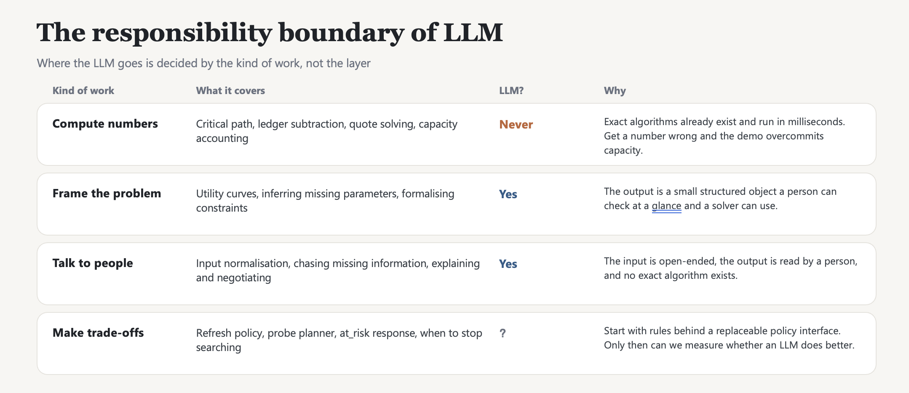

# what is it that we need the agentic framework for, instead of just a bunch of rules...

> 2026-09-26 与 Claude 讨论的整理稿，依据 8/25–9/22 会议记录和 [20260909_agentdesign.md](20260909_agentdesign.md)。以下是讨论得出的判断，**不是会议决定**，也还没有和 KK 对齐。

## 结论

- **可以写进 slides 的一句话**：Rules decide inside a well-defined problem; the agent keeps the problem well-defined when the world around it isn't.（规则只在良定义的问题里做决策；外部世界不规整时，由 agent 把问题维持成良定义的。）
- **LLM 不算数，但负责决策**：数字和承诺全部交给确定性工具；在 slow / long loop 中，由 LLM 决定"下一步做什么"。这样 LLM 进入的是控制平面，不只是前端界面。
- 9/9 的方案把 LLM 只放在入口归一化和解释输出两端，"做取舍"一律先用规则。评审很容易把它看成"规则系统加一个聊天界面"，所以不足以回答本题。

## 1. 先分清两种 "agent"

| 含义                                 | 对应的设计                                                             | 需要 LLM 吗                                           |
| ---------------------------------- | ----------------------------------------------------------------- | -------------------------------------------------- |
| 架构意义上的 agent：有自己的状态和目标的自治组件，通过协议协商 | Scheduling / Network / Compute / Site Agent；quote / hold / commit | 不需要。这是经典的 multi-agent negotiation（contract-net 一类） |
| LLM agent：在 harness 里推理并调用工具       | 本文讨论的对象                                                           | 需要                                                 |

第一种为什么必要，已经有答案：站点不会交出控制权，信息也只公开一部分（[0922 L90-97](meetings/20260922.md#L90-L97)）。但这个理由只能说明需要"分布式协商"，推不出需要"LLM"。

KK 在 9/21 已经用过一条隐含判据：Telemetry 只做确定性处理，所以叫 Service，不叫 Agent（[0921 L97-107](meetings/20260921_crosssite_architecture_telemetry.md#L97-L107)）。这条判据应该明确写出来，并逐个用到每个组件上。

## 2. 规则什么时候够用

需要同时满足四个前提：① 输入的 schema 封闭且事先已知；② 状态空间可以枚举；③ 目标函数已经给定；④ 异常种类可以预见。运行时只要有一条不成立，就只能靠人介入，或者交给 agent。

| 场景（出处）                                                                                                                                                                                                     | 不成立的前提 | 规则的处理方式                      | 对 LLM 的需求                    |
| ---------------------------------------------------------------------------------------------------------------------------------------------------------------------------------------------------------- | ------ | ---------------------------- | ---------------------------- |
| 站点信息异构、只公开一部分；Slurm / HTCondor / EPICS / K8s 各有格式（[0922 L90](meetings/20260922.md#L90)、[L175](meetings/20260922.md#L175)）                                                                                  | ①      | 每个站点手写 adapter，schema 一变就失效  | 高                            |
| 只能请求资源、不能命令：NRP 预约靠 admin chat；ASC / IRI 等设施有自己的 agent（[0922 L46](meetings/20260922.md#L46)、[L139-141](meetings/20260922.md#L139-L141)；[0918 L196-200](meetings/20260918_agentorchestration.md#L196-L200)） | ①④     | 对方是人，或是协议不固定的外部 agent，规则写不出来 | 高                            |
| 升级阶梯之外的故障，包括叠加故障、判断是网络还是端系统的问题（[0922 L297-299](meetings/20260922.md#L297-L299)）                                                                                                                            | ④      | 能处理预先列举的类型，处理不了长尾            | 中高：负责诊断、选择下一个 probe（类似 NIKA） |
| 科学方中途改需求，例如要求提前完成（[0922 L237](meetings/20260922.md#L237)）                                                                                                                                                  | ①      | 需要表单或人工处理                    | 中                            |
| 跨 workflow 取舍时的目标函数                                                                                                                                                                                        | ③      | 写不出来                         | 有边界冲突，见 §4                   |
| 优化求解、账本、遥测汇总                                                                                                                                                                                               | 四条都满足  | 规则或求解器就够                     | 无                            |

## 3. 分层：LLM 放在哪，不放在哪

**不能交给 LLM 的部分，有两条硬约束：**

- 延迟：gate metric 要求 agent 协调的 p50 < 200 ms（[0908 L49](meetings/20260908_scinet_agent.md#L49)），而一次 LLM 调用通常要 1 s 以上。
- 正确性：LLM 算错容量会造成 overcommit，这是 KK 点名要守住的底线。

因此 fast loop（≤30 s）、账本、quote 求解和 agent 之间的 typed protocol 一律用确定性实现。

**9/9 方案的缺口**在于把"不算数字"误当成了"不做决策"。Claude Code 这类 agent 系统里，LLM 从不自己计算，精确操作都交给工具；但下一步做什么、调用哪个工具、看到结果后要不要换方向，都由它决定。它不算数，却是控制中枢。

| 层   | 负责什么                                                                | 由谁承担                     |
| --- | ------------------------------------------------------------------- | ------------------------ |
| 控制  | 事件来了怎么处理：先诊断还是先修复；探测哪条链路；找 SENSE 换路径、降速，还是去和 Scheduling Agent 谈改时间窗 | LLM（只在 slow / long loop） |
| 执行  | 求解器、账本、容量校验、quote / hold / commit                                   | 确定性工具                    |
| 边界  | LLM 只能提出方案，由 verifier 校验可行性后才能 commit                               | harness                  |

这就是 propose–verify 模式。按三种循环分工如下：

- fast loop：只用规则。
- slow loop（分钟级）：LLM 作为控制平面，规则阶梯作为 baseline 和兜底。
- long loop：站点接入和外部协商由 LLM 承担。

它的一个变体是 "a bunch of rules" 本身由 agent 产出：N 个异构站点的规则没人能手写和维护，可以在接入站点时由 agent 生成并校验，运行时执行的仍然是确定性规则。这样既符合 KK 的 Service 判据，也不违反 200 ms 约束。

## 4. 冲突、风险与未证实之处

- **utility 曲线与合作方划的边界有冲突。** 9/22 明确说"本项目提供机制，不替实验定 policy 或 success metric"（[0922 L62](meetings/20260922.md#L62)），而 9/9 设想由 LLM 从 workflow 描述推出 utility 曲线。LLM 的角色必须表述为"从实验已声明的策略中提取、形式化，再交给人审核"。
- **digital twin 太干净。** twin 里的站点 schema 由我们自己定义，也没有人工管理员；Phase 1 demo 如果只跑在干净的 twin 上，规则 baseline 就能做到同样效果。demo 必须刻意注入开放世界的元素（异构且残缺的遥测、超出预设的故障），并与规则 baseline 做消融对比。
- **"LLM 在 slow loop 中优于规则"目前只是假设。** 把 policy 接口两侧的输入输出固定下来，这个问题就可以量化回答。

## 5. 候选证明点（待与 KK 对齐）

| 证明点                                                          | 能证明什么         | 可测的假设                                                              |
| ------------------------------------------------------------ | ------------- | ------------------------------------------------------------------ |
| **A. Network Agent 自修复失败后的 at_risk 处理**                      | LLM 能进入决策核心   | 在叠加或原因不明的链路故障下，LLM 提出方案、verifier 校验，比固定降级阶梯保住更多承诺，且 overcommit 为 0 |
| B. 站点网络遥测接入（可借 John 下次展示的 sFlow / Prometheus / NRP live 数据源） | LLM 在开放边界上的价值 | agent 生成的 site adapter 在接入成本和覆盖率上优于手写规则，正确性可通过读回数据验证               |

A 直接回答"LLM 是否落到核心"，建议优先做。

---

## **Compute numbers**

这里的 **Compute numbers** 不是指“计算资源”，而是指必须由确定性算法完成的精确数值计算：

- **Critical path（关键路径）**  
计算工作流依赖图中决定整体最早完成时间的最长路径。关键路径上的任务或传输一旦延迟，整个 workflow 就会延迟。
- **Ledger subtraction（资源账本扣减）**  
从资源总容量中扣除已经 `held` 或 `committed` 的容量，计算某个时间窗口内真正剩余的可用资源。  
例如：链路容量 100 Gbps，已承诺 40 Gbps、临时占用 20 Gbps，则剩余 40 Gbps。
- **Quote solving（Offer/报价求解）**  
根据任务需求、依赖关系、时间窗口和剩余容量，求出一个或多个可行的资源 offer，例如：  
“Site A 可以在 14:00 开始，使用 4 个 GPU，预计 16:00 完成。”
- **Capacity accounting（容量记账）**  
持续、权威地记录每项资源在什么时间被谁预留、承诺、使用或释放，避免重复分配和超额承诺。  
它和 ledger subtraction 的区别是：**capacity accounting 维护账本，ledger subtraction 查询并计算剩余容量。**

这些操作不应交给 LLM，因为结果必须精确、可重复、可审计。LLM 可以帮助理解需求和生成约束，但最终数字应由图算法、约束求解器和资源账本计算。

## Frame the problem

它指的是：**把用户模糊的自然语言需求，整理成求解器能够处理的结构化问题**。LLM 负责理解和表达问题，不负责计算最终资源数字。

- **Utility curves（效用曲线）**  
描述不同结果的价值。例如 18:00 前完成价值最高，之后完成得越晚价值越低，20:00 后结果无效。它让调度器比较“速度、成本、风险”等取舍。
- **Inferring missing parameters（推断缺失参数）**  
用户可能只说“尽快处理这些数据”，但没有说明截止时间、优先级、可接受成本等。LLM 可以提出默认值或追问用户，但推断结果应标记为假设，不能直接当成确定事实。
- **Formalising constraints（形式化约束）**  
将自然语言转换成明确的 hard/soft constraints。例如：
  - 至少需要 4 张 A100 GPU；
  - 数据在 14:00 才 ready；
  - 必须在 18:00 前完成；
  - 样品不能跨夜保存；
  - 优先使用成本较低的站点。

最终输出应当是一个简短、结构化且可检查的对象，然后交给确定性 solver 计算 critical path、offer 和容量。

## Talk to people

它指的是：**LLM 负责系统与人之间的自然语言交互**，将人的表达转换成系统能处理的结构化信息，也把系统结果解释给人。

- **Input normalisation（输入标准化）**  
将不同用户、不同表达方式统一成标准字段。  
例如将“明天下午把数据尽快传过去”转换为：
  - `earliest_start`
  - `source`
  - `destination`
  - `data_size`
  - `priority`
- **Chasing missing information（追问缺失信息）**  
主动发现完成请求所缺少的内容并询问用户。  
例如：“目标站点是哪个？”“是否有硬性截止时间？”“可以使用哪些 GPU 类型？”
- **Explaining（解释）**  
把调度结果、失败原因和风险转换成容易理解的语言。  
例如：“Site A 虽然计算更快，但网络传输需要两小时，因此选择 Site B 可以更早完成整个 workflow。”
- **Negotiating（协商）**  
当原始要求无法满足时，与用户或站点管理员讨论替代方案。  
例如：“无法在 18:00 前使用 8 张 GPU 完成；可以选择延迟到 19:00，或者减少到 4 张 GPU 并降低任务规模。”

这部分适合使用 LLM，因为输入是开放、模糊且多样的，输出也是给人阅读的。但 LLM 只能负责沟通和形成结构化请求，**不能自己承诺资源或修改资源账本**。

## Make trade-offs

它指的是：当没有唯一的“正确答案”时，系统需要在**性能、成本、风险和决策开销**之间做选择。

- **Refresh policy（刷新策略）**  
决定什么时候重新获取 resource offer 或更新调度方案。刷新太频繁会增加系统开销，太慢又可能使用过期信息。  
例如：每 5 分钟刷新一次，或者收到 `at_risk` 事件时立即刷新。
- **Probe planner（探测规划）**  
决定是否值得进行额外测量，以及测量哪个资源。  
例如：Site A 可能更快，但网络状态不确定；系统需要判断是否先运行一次带宽测试，再决定选择 A 还是 B。
- `at_risk` **response（风险响应）**  
当已有承诺可能无法兑现时，选择如何处理。  
例如在以下方案中权衡：
  - 等待资源恢复；
  - 更换计算站点；
  - 重新预留网络；
  - 接受延迟；
  - 请求用户降低资源需求。
- **When to stop searching（何时停止搜索）**  
决定什么时候已有方案“足够好”，不再继续寻找更优方案。继续搜索可能得到更好的计划，但也会消耗时间，并可能错过当前 offer 的有效期。

> 例如系统可能不断尝试：
>
> - 换一个 compute site；
> - 换一个 instrument 或预约时间；
> - 调整任务开始时间；
> - 选择另一条网络路径或带宽；
> - 重新组合计算、仪器和网络 offer；
> - 等待新的 offer，看看能否获得更好的完成时间、成本或可靠性。
>
> **When to stop searching** 就是决定：什么时候当前方案已经足够好，可以停止继续优化并正式提交。
>
> 例如：已经找到一个能在 deadline 前完成、风险可接受且资源已确认的方案，就可以停止；否则继续搜索可能导致当前 offer 过期，反而错失可行方案。

这部分是否应该使用 LLM，目前不能直接确定。比较稳妥的方法是：

1. 先用可解释的规则或传统优化策略实现；
2. 将策略放在可替换的 policy interface 后面；
3. 再通过实验比较 LLM 是否能提高成功率、效用或故障恢复能力。

核心区别是：**solver 负责计算哪些方案可行以及准确数字；trade-off policy 负责从多个可行方案中决定选哪个、何时重算、何时停止。**

